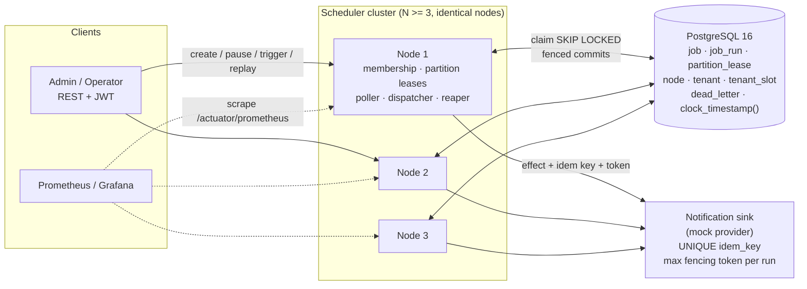
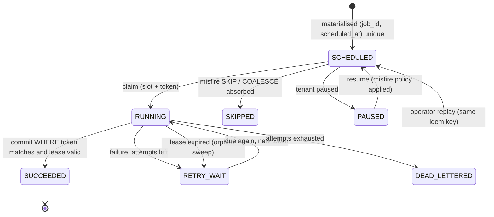
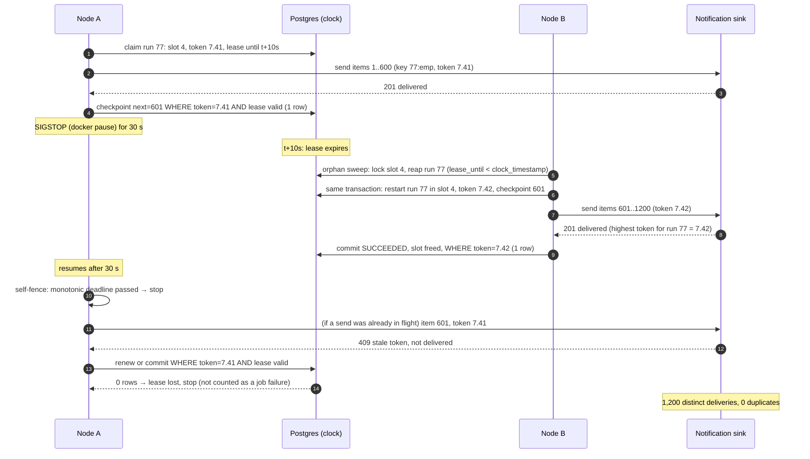

# Distributed Trip Job Scheduler

> MoveInSync · Case Study 3 · Implementation plan

A Java 21 / Spring Boot scheduler that runs rosters, pickup alerts, no-show cancels and billing close across three or more nodes. Each side effect happens once even when a node is killed or frozen. Postgres is the only coordinator, and no single row is a hot lock.

| 100,000 | 3 nodes | < 2 s | 128 | 10 s |
|---|---|---|---|---|
| jobs due in a 10-min window | minimum cluster | p99 fire lag target | fixed job partitions | run lease, renewed every 3 s |

## Contents

1. [Hard rules](#01-hard-rules-pulled-from-the-brief)
2. [Guarantees](#02-what-we-guarantee-and-why-exactly-once-execution-is-impossible)
3. [Stack](#03-technology-choices)
4. [Architecture](#04-architecture)
5. [Data model](#05-data-model)
6. [Partitions & leases](#06-partitioning-and-membership-no-single-hot-lock)
7. [Claim, fence, commit](#07-claim-fence-execute-commit)
8. [Cron & DST](#08-recurring-jobs-time-zones-and-dst)
9. [Misfire & retries](#09-misfires-retries-and-the-dead-letter-list)
10. [Fairness numbers](#10-per-tenant-fairness-with-numbers)
11. [Freeze sequence](#11-hardest-flow-freeze-takeover-stale-write-rejected)
12. [Failure modes](#12-failure-mode-table)
13. [API & auth](#13-api-and-access-control)
14. [Metrics, cache, errors](#14-metrics-logging-caching-and-errors)
15. [Code layout](#15-code-layout-and-oop-design)
16. [Test matrix](#16-test-matrix-every-hard-rule-is-automated)
17. [Benchmark](#17-benchmark-plan-and-capacity-math)
18. [Trade-offs](#18-trade-offs-and-deliberate-omissions)
19. [Roadmap](#19-delivery-roadmap)
20. [Demo script](#20-demo-video-script-about-6-minutes)
21. [Review fixes](#21-design-review-issues-found-and-fixed)

---

## 01. Hard rules pulled from the brief

Every rule gets an ID. Each ID appears again in the [test matrix](#16-test-matrix-every-hard-rule-is-automated), so every hard rule has at least one automated test.

| ID | Rule | Where it is solved |
|---|---|---|
| R1 | One-off jobs (run at an instant) and recurring jobs (cron), each with tenant, payload, priority, max run time | `job` table, `JobDefinition` hierarchy |
| R2 | Recurring jobs run in tenant time zone, including DST gap (02:30 on spring-forward) and overlap (01:30 twice) | `WallClockResolver` (§08) |
| R3 | At-least-once execution with an idempotency key per run, so the side effect happens exactly once | Run key + item key, idempotent sink (§07) |
| R4 | Time-limited lease plus fencing token; a node waking after lease expiry cannot commit | Epoch-prefixed token pair, fenced writes that fail once a lease expires, sink-side token check, self-fencing (§07) |
| R5 | No single hot lock; partitions move when nodes join or leave | 128 partition leases + rendezvous hashing + orphan sweep (§06) |
| R6 | Misfire policy per job: fire now, skip, coalesce | `MisfirePolicy` sealed interface (§09) |
| R7 | Per-tenant concurrency cap; one tenant's 50,000 alerts must not delay another's 20 | Tenant slot table enforced by DB constraints + deficit round robin (§10) |
| R8 | Exponential backoff with jitter, then dead-letter list an operator can inspect and replay | `BackoffPolicy`, `DEAD_LETTERED` state, DLQ API |
| R9 | Pause/resume a tenant, list next fire times, manual trigger | Ops API (§13) |
| R10 | Fire-lag histogram; running, retrying and dead-lettered counts | Micrometer + Prometheus (§14) |
| R11 | kill -9 while sending 1,200 alerts: takeover within lease time, every employee gets one alert | Chunked handler + checkpoint + chaos test |
| R12 | SIGSTOP for 30 s: lease expires, another node finishes, the stale write is rejected | Fencing + `docker pause` chaos test (§11) |
| R13 | 100k jobs in 10 min on 3 nodes with p99 fire lag < 2 s | Load generator + HdrHistogram report (§17) |
| R14 | RBAC (employee / admin / operator) with tenant isolation; no PII in logs or errors | JWT + repository tenant scoping + log masking |
| R15 | One-command run, README with benchmark and machine, design note, demo video, meaningful commits | `docker compose up`, `docs/`, roadmap (§19) |

---

## 02. What we guarantee, and why exactly-once execution is impossible

A node can do the work (send the SMS) and then die before it records that the work happened. To everyone else that looks the same as a node that died before sending. A node in a 30-second GC pause also looks the same as a dead node. No protocol can tell these cases apart in an asynchronous network with crash failures (the FLP result and the Two Generals problem). The scheduler has two choices: retry and maybe repeat the work (at-least-once), or never retry and maybe lose it (at-most-once). Losing jobs is not allowed, so we retry.

> **The guarantee:** each scheduled occurrence is *executed* at least once and *takes effect* exactly once. Every effect carries a deterministic idempotency key, and the receiving side stores it with a unique constraint. Every write that changes state carries a fencing token, and both the scheduler DB and the sink reject writes with an outdated token.
>
> **The assumption:** each downstream system either honours idempotency keys (our notification sink does) or is wrapped by a dedupe table we control. A non-idempotent third-party API cannot be made exactly-once by any scheduler, and the README says so.
>
> **Across a Postgres failover:** no acknowledged write is lost and fencing tokens never go backwards, as long as the failover requirements F1–F5 in [§12](#12-failure-mode-table) hold. If they cannot be met, writes stop rather than continue unprotected.

### Which clock decides when a job is due

- **The Postgres primary's clock is the only clock that decides due times and lease expiry.** Nodes never compare their own wall clock with `due_at` or `lease_until`. Every due check and lease check is a SQL predicate evaluated in the database with `clock_timestamp()`, the current time. `now()` is the time the transaction started, so a transaction that began just before a lease expired would still see it as valid.
- A node whose clock is skewed by 5 minutes therefore fires on time. Skew only changes log timestamps, and logs also record the DB timestamp.
- Each node uses its own **monotonic clock** (`System.nanoTime`) for one thing: self-fencing. If it has not renewed a lease within `lease − 2 s` of local elapsed time, it stops starting new side effects. CLOCK_MONOTONIC keeps advancing while a process is SIGSTOPped, so a frozen node sees on wake-up that its deadline has passed.
- Fire lag is measured as `started_at(DB) − scheduled_at`, both on the DB clock.
- **Assumption:** the primary's clock never steps backwards, because Postgres has no monotonic clock in SQL. NTP runs in slew mode on every database node, and database nodes stay well within the 2 s lease safety margin of each other, so a failover to another machine doesn't noticeably move lease expiry.

---

## 03. Technology choices

| Concern | Choice | Why |
|---|---|---|
| Language / runtime | Java 21, Spring Boot 3.3 | Preferred by the brief; records and sealed interfaces fit the domain; virtual threads for blocking I/O in handlers |
| Coordinator + store | PostgreSQL 16 | `FOR UPDATE SKIP LOCKED`, sequences for fencing tokens, a transactional state machine, and a single trusted clock. A ZooKeeper or Kafka cluster would add more to run without fixing anything Postgres cannot handle at this scale. In production, Patroni with etcd manages failover under the rules in §12. |
| Data access | Spring `JdbcClient` + Flyway | Claim and fence SQL must be exact; JPA hides the conditional updates we depend on |
| Cron | Spring `CronExpression` on `LocalDateTime` + own DST resolver | Cron is matched on wall time, and our own code turns wall time into an instant, so DST policy is explicit and tested |
| Cache | Caffeine | In-process, size and TTL eviction, metrics built in |
| Security | Spring Security resource server, HS256 JWT | Roles and tenant claim in the token; dev token endpoint for the demo |
| Metrics / logs | Micrometer → Prometheus → Grafana; logstash JSON encoder | Histogram with SLO buckets; MDC fields for run, job, tenant, node, token |
| Tests | JUnit 5, AssertJ, Testcontainers, Awaitility, Toxiproxy | Real Postgres in tests; network faults injected on demand |
| Load / chaos | Java load generator + HdrHistogram; shell chaos scripts (`docker kill -s KILL`, `docker pause`) | Reproducible R11–R13 runs that write numbers into the README |

---

## 04. Architecture

Every node runs the same jar, so there is no leader. Each node runs five loops. The **membership** loop heartbeats. The **partition** loop acquires and renews partition leases. The **poller** claims due runs from owned partitions. The **dispatcher** runs them under per-tenant caps. The **orphan sweep** takes over runs whose lease expired, in any partition. A separate notification sink stands in for the real SMS/push provider and enforces idempotency keys and fencing tokens, which is what the tests check.



### Run state machine



---

## 05. Data model

```sql
CREATE TABLE tenant (
  id            TEXT PRIMARY KEY,
  time_zone     TEXT NOT NULL,              -- e.g. 'Asia/Kolkata', 'America/New_York'
  paused        BOOLEAN NOT NULL DEFAULT false,
  configured_cap INT NOT NULL DEFAULT 32,   -- cap the admin set; effective cap = slot rows (R7)
  version       BIGINT NOT NULL DEFAULT 0
);

CREATE TABLE tenant_slot (                -- exactly one row per unit of concurrency
  tenant_id     TEXT NOT NULL REFERENCES tenant(id),
  slot_no       SMALLINT NOT NULL,          -- 0 .. cap-1 (higher only while a reduction drains)
  PRIMARY KEY (tenant_id, slot_no)
);                                          -- who holds a slot is recorded only in job_run.slot_no

CREATE TABLE cluster_meta (
  id            BOOLEAN PRIMARY KEY DEFAULT true CHECK (id),
  cluster_generation INT NOT NULL CHECK (cluster_generation BETWEEN 0 AND 2147483647)
);                                          -- operators raise it when rebuilding from a fresh initdb

CREATE TABLE job (
  id            UUID PRIMARY KEY,
  tenant_id     TEXT NOT NULL REFERENCES tenant(id),
  kind          TEXT NOT NULL,              -- ONE_OFF | RECURRING
  handler       TEXT NOT NULL,              -- PICKUP_ALERT | ROSTER_GEN | NO_SHOW_CANCEL | BILLING_CLOSE
  cron          TEXT,                       -- recurring only, wall-clock in tenant zone
  run_at        TIMESTAMPTZ,                -- one-off only
  payload       JSONB NOT NULL,             -- may hold PII; never logged
  priority      SMALLINT NOT NULL DEFAULT 5,
  max_run_time  INTERVAL NOT NULL,
  misfire       TEXT NOT NULL,              -- FIRE_NOW | SKIP | COALESCE
  misfire_threshold INTERVAL NOT NULL DEFAULT '60 seconds',
  max_attempts  SMALLINT NOT NULL DEFAULT 5,
  partition_id  SMALLINT NOT NULL,          -- murmur3(id) % 128
  next_fire_at  TIMESTAMPTZ,                -- materialiser cursor
  version       BIGINT NOT NULL DEFAULT 0,  -- definition version (cache key)
  enabled       BOOLEAN NOT NULL DEFAULT true
);

CREATE TABLE job_run (
  id            BIGSERIAL PRIMARY KEY,
  job_id        UUID NOT NULL REFERENCES job(id),
  tenant_id     TEXT NOT NULL,
  partition_id  SMALLINT NOT NULL,
  scheduled_at  TIMESTAMPTZ NOT NULL,       -- the occurrence instant
  due_at        TIMESTAMPTZ NOT NULL,       -- scheduled_at, or retry time
  idem_key      TEXT NOT NULL,              -- jobId:scheduledAtUTC | jobId:manual:requestId
  state         TEXT NOT NULL,
  attempt       SMALLINT NOT NULL DEFAULT 0,
  fencing_epoch BIGINT,                     -- cluster_generation * 2^32 + timeline (§07)
  fencing_seq   BIGINT,                     -- nextval('fence_seq') on every claim
  slot_no       SMALLINT,                   -- tenant slot held while RUNNING, NULL otherwise
  owner_node    TEXT,
  lease_until   TIMESTAMPTZ,
  started_at    TIMESTAMPTZ,
  finished_at   TIMESTAMPTZ,
  checkpoint    JSONB,                      -- e.g. {"nextItem": 650} for chunked jobs
  coalesced_count INT NOT NULL DEFAULT 1,
  last_error    TEXT,                       -- error code + sanitised message only
  UNIQUE (job_id, scheduled_at),            -- materialisation is idempotent
  UNIQUE (idem_key),
  -- a running run's slot must be a real slot row of its own tenant
  FOREIGN KEY (tenant_id, slot_no) REFERENCES tenant_slot (tenant_id, slot_no) ON DELETE RESTRICT,
  -- a running run always holds a slot and a token
  CHECK (state <> 'RUNNING' OR (slot_no IS NOT NULL AND fencing_seq IS NOT NULL))
);
CREATE SEQUENCE fence_seq CACHE 1;          -- strictly increasing within an epoch, no row lock

-- no two running runs share a slot: running runs per tenant <= slot rows, enforced by the DB
CREATE UNIQUE INDEX one_run_per_slot ON job_run (tenant_id, slot_no) WHERE state = 'RUNNING';
CREATE INDEX run_due     ON job_run (partition_id, tenant_id, due_at) WHERE state IN ('SCHEDULED','RETRY_WAIT');
CREATE INDEX run_expired ON job_run (lease_until)                     WHERE state = 'RUNNING';  -- orphan sweep

CREATE TABLE partition_lease (
  partition_id  SMALLINT PRIMARY KEY,       -- 128 rows, one per partition
  owner_node    TEXT,
  epoch         BIGINT NOT NULL DEFAULT 0,
  lease_until   TIMESTAMPTZ
);

CREATE TABLE scheduler_node (
  node_id       TEXT PRIMARY KEY,
  heartbeat_at  TIMESTAMPTZ NOT NULL,       -- DB clock
  started_at    TIMESTAMPTZ NOT NULL
);

CREATE TABLE dead_letter (
  run_id        BIGINT PRIMARY KEY REFERENCES job_run(id),
  tenant_id     TEXT NOT NULL,
  error_code    TEXT NOT NULL,
  attempts      SMALLINT NOT NULL,
  dead_at       TIMESTAMPTZ NOT NULL,
  replayed_at   TIMESTAMPTZ
);

CREATE TABLE api_idempotency (            -- retry-safe API writes (24 h retention)
  tenant_id     TEXT NOT NULL,
  idem_key      TEXT NOT NULL,
  request_hash  TEXT NOT NULL,
  response      JSONB NOT NULL,
  created_at    TIMESTAMPTZ NOT NULL,
  PRIMARY KEY (tenant_id, idem_key)
);

-- Notification sink (separate schema, owned by the sink service)
CREATE TABLE sink.delivery   (idem_key TEXT PRIMARY KEY, run_id BIGINT, fencing_epoch BIGINT, fencing_seq BIGINT, delivered_at TIMESTAMPTZ);
CREATE TABLE sink.run_fence  (run_id BIGINT PRIMARY KEY, max_epoch BIGINT NOT NULL, max_seq BIGINT NOT NULL);
CREATE TABLE sink.attempt_log(id BIGSERIAL, idem_key TEXT, fencing_epoch BIGINT, fencing_seq BIGINT, outcome TEXT, at TIMESTAMPTZ);
```

The sink keeps an `attempt_log` so the tests can show both sides: duplicates *were attempted* (at-least-once) and only one *was delivered* per key (exactly-once effect).

---

## 06. Partitioning and membership (no single hot lock)

1. **Fixed partitions.** `partition_id = murmur3(job_id) mod 128`, set at creation and never changed. Runs inherit it. 128 allows growth to about 40 nodes while keeping each partition small.

2. **Heartbeat.** Each node upserts `scheduler_node.heartbeat_at = now()` every 2 s. A node is *live* if its heartbeat is less than 6 s old by DB time. Only one row per node is written, so nodes do not contend.

3. **Desired assignment.** Each node reads the live set and computes rendezvous (highest-random-weight) hashing: <code>owner(p) = argmax<sub>n</sub> hash(n, p)</code>. Every node computes the same answer without talking to the others. When a node joins or leaves, only about `128/N` partitions move.

4. **Acquire / renew** (one row per partition, so contention is per row and spread across 128 rows):

   ```sql
   UPDATE partition_lease
      SET owner_node = :me, epoch = epoch + 1, lease_until = clock_timestamp() + interval '6 s'
    WHERE partition_id = :p
      AND (owner_node = :me OR lease_until < clock_timestamp());
   ```

   Renew every 2 s; the partition loop runs every 1 s. Release partitions that are no longer desired so the new owner picks them up immediately. When a partition's lease expires, its previous owner is treated as dead for that partition straight away, so acquiring it doesn't wait for the 6 s membership check. On a crash, partitions move within about 7 s, before the 10 s run lease expires.

5. **Correctness never depends on partition ownership.** Partition leases only spread polling load. If two nodes briefly poll the same partition during a handover, `SKIP LOCKED` and the run-level fencing token still allow only one claim per run. Ownership gaps can only add lag, never duplicates.

6. **Orphan sweep.** Every 1 s, each node also takes over expired `RUNNING` runs in *any* partition, through the shared claim protocol (§07) and the `run_expired` index. Taking over a running job therefore never waits for partition ownership. Recovered runs go to the front of the dispatch queue, and each node keeps one worker free for them, so takeover doesn't queue behind new work. **Takeover bound: ≤ 11.2 s** (10 s run lease after its last renewal + up to 1 s sweep + about 0.2 s claim), given at least one live node.

> **Why this beats one lock row:** Quartz-style clustering serialises every trigger acquisition through one `QRTZ_LOCKS` row, so throughput is capped by lock hand-off latency (about 1–3 ms), roughly 300–1,000 acquisitions/s shared by all nodes. Here, claims from different nodes touch different partitions and different run rows. The fencing sequence is non-transactional and takes no row lock.

---

## 07. Claim, fence, execute, commit

### Claim (every 200 ms, per node)

One class, `ClaimProtocol`, is the only code that writes run state or slots. Polling, the orphan sweep, manual triggers and dead-letter replays all use it, so no path can skip the rules below. The claim runs *per tenant* (paused tenants are skipped by reading `tenant.paused` directly), so a burst from one tenant cannot fill the batch (R7), and a run starts only if it gets one of its tenant's slots. Locks are always taken in the same order, **slot row first, then run row**. Commits never lock slot rows, so claims cannot deadlock with each other or with commits.

```sql
BEGIN;
-- 1. Lock up to k slots of tenant :t that look free. This filter is only a hint; step 2 decides.
SELECT s.slot_no, r.id AS holder
  FROM tenant_slot s
  LEFT JOIN job_run r ON r.tenant_id = s.tenant_id AND r.slot_no = s.slot_no AND r.state = 'RUNNING'
 WHERE s.tenant_id = :t
   AND (r.id IS NULL OR r.lease_until < clock_timestamp())
 ORDER BY s.slot_no
 LIMIT :k
   FOR UPDATE OF s SKIP LOCKED;

-- 2. For each locked slot that still has a holder, reap it with a conditional update.
--    It waits on the holder's row lock and re-checks the WHERE clause on the newest row version,
--    so it cannot race a concurrent renewal: exactly one of the two succeeds.
UPDATE job_run SET state = 'RETRY_WAIT', due_at = clock_timestamp(), slot_no = NULL
 WHERE id = :holder AND state = 'RUNNING' AND lease_until < clock_timestamp();
--    1 row  => the slot is free;   0 rows => the holder renewed in time, skip this slot

-- 3. Start one due run per free slot (the orphan sweep restarts the reaped run itself, in the same slot)
UPDATE job_run r
   SET state = 'RUNNING', slot_no = :slot, owner_node = :me,
       fencing_epoch = :epoch, fencing_seq = nextval('fence_seq'),
       lease_until = clock_timestamp() + interval '10 s',
       started_at = coalesce(r.started_at, clock_timestamp()), attempt = r.attempt + 1
 WHERE r.id = (SELECT id FROM job_run
                WHERE partition_id = ANY(:owned) AND tenant_id = :t
                  AND state IN ('SCHEDULED','RETRY_WAIT') AND due_at <= clock_timestamp()
                ORDER BY priority_rank, due_at
                LIMIT 1
                FOR UPDATE SKIP LOCKED)
RETURNING r.id, r.fencing_epoch, r.fencing_seq, r.idem_key, r.checkpoint, r.scheduled_at;
COMMIT;   -- the token is used only after this commit is acknowledged
```

Nothing is claimed that cannot start right away, so leases are never held by jobs waiting in a queue.

### Execute

- The handler receives a `RunContext(runId, idemKey, fencingToken, checkpoint, deadline)`. Every outbound effect sends `Idempotency-Key` and `Fencing-Token: <epoch>.<seq>` headers.

- A lease renewer extends the lease every 3 s. **An expired lease can never be renewed**, even if nobody has taken the run over yet:

  ```sql
  UPDATE job_run SET lease_until = clock_timestamp() + interval '10 s'
   WHERE id = :run AND (fencing_epoch, fencing_seq) = (:e, :s)
     AND state = 'RUNNING' AND lease_until >= clock_timestamp();
  -- 0 rows => lease lost: interrupt the handler and stop
  ```

- **Chunked handlers** (1,200 pickup alerts) send in chunks of 50 and checkpoint after each chunk, using the same fenced predicate. Item key: `{idemKey}:{employeeId}`.

- A hard stop at `max_run_time` marks the attempt failed (timeout), and normal retry applies.

### Commit (fenced)

```sql
UPDATE job_run SET state = 'SUCCEEDED', finished_at = clock_timestamp(), slot_no = NULL
 WHERE id = :run AND (fencing_epoch, fencing_seq) = (:e, :s)
   AND state = 'RUNNING' AND lease_until >= clock_timestamp();
-- 0 rows  =>  lease lost: StaleFencingTokenException, scheduler_stale_commit_rejected_total++
```

Setting `slot_no` to NULL frees the slot in the same fenced statement, so a late commit from a zombie can never free a slot that now belongs to another run. Checkpoints use the same predicate. A commit that arrives after expiry is rejected; the run executes again and its effects are deduplicated.

### Fencing token across failover

- The token is a pair `(fencing_epoch, fencing_seq)`, compared epoch first, then sequence. No bit-packing of the sequence, so there is no range limit.
- <code>fencing_epoch = cluster_generation × 2<sup>32</sup> + timeline</code>. The timeline is Postgres's unsigned 32-bit timeline ID, which rises on every promotion; it is read from the current WAL file name (`pg_walfile_name(pg_current_wal_lsn())`, first 8 hex digits). `cluster_generation` is capped at 2<sup>31</sup> − 1 by a CHECK, so the epoch always fits in a non-negative BIGINT. If the timeline read is NULL or not positive, the claim fails closed and nothing starts.
- `cluster_generation` covers a rebuild from a fresh `initdb`, which restarts at timeline 1. Operators must raise it then. On startup each node compares the current epoch with the highest epoch the sink has recorded and refuses to run if it is lower.
- A token is used only after its claim commit is acknowledged. That also covers a crash and restart on the same server, where the timeline does not change.

### Three layers stop a stale node

#### 1 · Self-fencing (local)

Monotonic deadline `claimTime + lease − 2 s`. On wake-up after SIGSTOP the check fails before the next send. This is cheap, but it is not enough alone: the pause can land between the check and the send.

#### 2 · Sink fencing (effect)

The sink keeps the highest `(epoch, seq)` per run and rejects any request with a lower token (409). The unique `idem_key` absorbs legitimate retries. This layer makes the side effect safe.

#### 3 · DB fencing (state)

Every checkpoint, renew and commit requires a matching token *and* a lease that is still valid. A stale node cannot mark a run done, move a checkpoint backward, free a slot, or overwrite the new owner's result.

#### Orphan sweep

Every 1 s, in any partition: an expired `RUNNING` run is reaped and restarted in one claim transaction, in the same slot, with a higher token, from its checkpoint. Takeover ≤ 10 s lease + 1 s sweep + 0.2 s claim.

---

## 08. Recurring jobs, time zones and DST

Cron expressions are evaluated against **local wall time** in the tenant zone. The `WallClockResolver` then maps each local time to exactly one instant. A materialiser fills `job_run` up to 15 minutes ahead (idempotent thanks to `UNIQUE(job_id, scheduled_at)`) and advances `job.next_fire_at`.

| Case | Example (America/New_York) | Our rule | Fires at (UTC) |
|---|---|---|---|
| **Gap** (spring forward) | Sun 8 Mar 2026: 02:00 → 03:00. Job `30 2 * * *` | The skipped wall time fires once, **at the instant the gap ends (03:00 local)**, like Vixie cron. This is deliberately *not* Java's default shift to 03:30, because a nightly job should not move later than needed. | 07:00Z |
| **Overlap** (fall back) | Sun 1 Nov 2026: 01:00–01:59 occurs twice. Job `30 1 * * *` | Fires **once, at the first occurrence** (EDT, −04:00). The idempotency key is built from the resolved instant, and only one instant is ever produced per local occurrence. | 05:30Z |
| Overlap, sub-hourly job | `*/15 * * * *` | Wall-clock matching would skip the second 01:xx hour. We document this: such jobs fire for each distinct local time once, so there are 4 runs, not 8, in the repeated hour. Teams that need elapsed-time spacing use a fixed-rate job (left out, see §18). | — |
| No-DST zone | Asia/Kolkata, 22:00 roster | Straight mapping, 16:30Z every day. | 16:30Z |
| Tenant changes zone | Admin edits `time_zone` | Bump the job version; delete unstarted future runs and re-materialise them. Runs already started are not touched. | — |

Unit tests pin these exact dates and also run against Europe/London (last Sundays of March and October) to show the rule does not depend on a particular zone.

---

## 09. Misfires, retries and the dead-letter list

A run has *misfired* when it is claimed with `now() − scheduled_at > misfire_threshold` (default 60 s), usually after cluster downtime or a long pause of a tenant. The policy is a sealed interface with three implementations, applied when the poller claims:

| Policy | Behaviour after 3 h downtime, hourly job (3 missed) | Good for |
|---|---|---|
| `FIRE_NOW` | All 3 missed runs fire immediately, in order, each with its own key | Billing close per day: each period must be closed |
| `SKIP` | Missed runs → `SKIPPED`; the next future occurrence runs normally | "Cab assigned" alerts: an alert after pickup time is useless |
| `COALESCE` | Newest missed run fires once with `coalesced_count = 3`; the other two → `SKIPPED` | Roster regeneration: only the latest state matters |

### Retries

- Backoff: <code>delay = random(0, min(cap, base · 2<sup>attempt</sup>))</code> ("full jitter"), base 2 s, cap 5 min. Retry sets `state = RETRY_WAIT, due_at = now() + delay`, so it waits in the same index and needs no extra queue.
- Errors are classified by type: `RetryableJobException` (timeouts, 5xx) is retried; `PermanentJobException` (bad payload, 4xx) is dead-lettered immediately.
- A 409 for an outdated token, or a fenced write that updates 0 rows, means **lease lost**, not job failure: the handler stops and the attempt doesn't count toward `max_attempts`. Lease-lost attempts have their own limit of 20. After that the run is dead-lettered with `FENCING_CONFLICT` and an alert fires, so a fencing bug can't loop forever.
- After `max_attempts`, the run becomes `DEAD_LETTERED` and a row is written to `dead_letter`. Operators can list, filter and inspect error codes (never payload PII), and replay. Replay keeps the **same idempotency key**, so any items that were delivered before the run died are not sent again.

---

## 10. Per-tenant fairness, with numbers

Two mechanisms work together. **Slots enforce the cap**: each tenant has exactly `cap` rows in `tenant_slot`, and a run can only be `RUNNING` while holding one (§07). This is one shared record in the database, so it doesn't depend on which node owns which partition. **Deficit round robin decides the order**: claimed runs go into per-tenant queues, and the worker pool takes from tenants in turn, weighted by priority, so a small tenant is never stuck behind a deep queue.

| Scenario at 08:00:00 | Without caps (global FIFO) | With caps (cap 32 / tenant) |
|---|---|---|
| Cluster capacity | 3 nodes × 64 workers = 192 slots; alert send ≈ 40 ms → 4,800 runs/s |  |
| Tenant A: 50,000 alerts | drains in 50,000 / 4,800 ≈ 10.4 s | 32 / 0.04 s = 800/s → 62.5 s |
| Tenant B: 20 alerts | queued behind A: up to 10.4 s lag **fails** | starts on the next 200 ms poll: lag < 0.3 s **passes** |
| Idle capacity left for others | 0 slots | 160 slots |

> **Trade-off made visible:** a hard cap leaves capacity idle while tenant A waits. Alerts go out 30 minutes before pickup, so a 62 s drain is fine. The cap is configurable per tenant (A could get 96, which drains in about 21 s). A cap is not work-conserving; we pick isolation over peak throughput because the brief asks for it. The README includes the measured version of this table.

### Why the cap holds at every moment

- Every running run holds a slot (CHECK constraint), the slot exists and belongs to the same tenant (composite foreign key), and no slot is used twice (partial unique index). So **running runs of a tenant ≤ its slot rows**, and the database enforces it even if the application has a bug.
- A slot passes to a new run only after the old run is reaped by a conditional update, which is the same moment its node loses the right to write (§07). This holds during partition moves, node crashes and the orphan sweep, with no tolerance.
- Exact guarantee: at most `cap` runs per tenant hold a valid lease at any moment. No system can stop a frozen process from running for a moment when it wakes; fencing rejects anything it does.
- Cost: one slot-row lock per run start, inside the claim transaction. Freeing the slot is part of the commit statement, so it adds no extra write. Tenants never touch each other's slot rows.

### Changing a cap

Each tenant has two numbers: `configured_cap` (what the admin set) and the **effective cap**, which is its number of slot rows. The rule "running ≤ effective cap" has no exceptions.

- **Raising** a cap inserts slot rows at once; they are usable on the next poll.

- **Lowering** a cap is deferred. Example: 28 running, cap lowered from 32 to 16.

  1. Free slot rows numbered 16 or higher are deleted at once. `ON DELETE RESTRICT` makes it impossible to delete a slot in use.
  2. **Compaction:** whenever a slot below 16 becomes free, one running run moves from a high slot into it. Both slot rows are locked first, then the run row, using the same order as a claim. Then the empty high slot row is deleted.
  3. A claim needs a free slot, and compaction fills every free low slot first, so **no new run starts until fewer than 16 are running**.

  During the reduction, the effective cap equals the larger of 16 and the current running count, and it only goes down. It reaches 16 within the longest remaining `max_run_time` of the runs that were already active. Running jobs are not stopped. An optional `force=true` revokes their leases instead; fencing makes that safe.

- The tenant API shows `draining: true` while effective > configured.

---

## 11. Hardest flow: freeze, takeover, stale write rejected



The **kill -9** case is the same flow without steps 10–14. Items sent after the last checkpoint and before the crash (up to 49) are resent by B and absorbed by the sink's unique `idem_key`. Takeover takes at most 11.2 s whichever moment the kill lands, because the orphan sweep doesn't wait for partition ownership. The token `7.41` is epoch 7 (generation 0, timeline 7), sequence 41.

---

## 12. Failure-mode table

| What fails | What the user sees | How the system recovers |
|---|---|---|
| Node killed (kill -9) mid-run | Alerts for that run pause ≤ 11.2 s, then continue; nobody gets two | Run lease expires → orphan sweep on any node reaps and restarts it in the same slot with a higher token → resume from checkpoint; sink dedups the replayed chunk |
| Node frozen (GC pause, SIGSTOP) | Same as kill; on resume nothing changes | Self-fence + sink token check + fenced DB writes that fail once the lease expired (§11) |
| Node crash, partitions orphaned | New due runs in those partitions wait up to about 7 s | Partition leases (6 s) expire; the expired owner is treated as dead at once; rendezvous hashing gives them to live nodes. Running jobs are taken over by the orphan sweep, independently. |
| Lease renewal and slot reuse at the same moment | Nothing | Both update the same run row; Postgres runs them one at a time and exactly one succeeds (§07) |
| Node joins | Nothing visible | About 128/N partitions handed over through release and acquire; no gaps, because the old owner releases only after the new owner is live |
| Postgres unreachable | No jobs fire; API returns 503 `SCHEDULER_STORE_UNAVAILABLE` | Nodes self-fence (cannot renew), stop starting effects, and retry with backoff. When the DB returns, the misfire policy handles the backlog. We choose consistency over availability. |
| Postgres primary fails (production) | Writes pause for about 10–30 s while Patroni promotes; nothing acknowledged is lost | Only the synchronous standby is promoted (F3). The new timeline raises the token epoch, so new tokens beat every old one and clients of the old primary are rejected. Nodes reconnect with `target_session_attrs=read-write`. |
| No synchronous standby available | Writes block; no jobs fire | Strict synchronous mode (F2). Resumes when a standby returns; chosen on purpose over unprotected writes |
| Commit outcome unknown (primary died before a standby confirmed) | API client gets an error | Client retries with the same `Idempotency-Key` and gets one result. Claims never use a token whose commit wasn't confirmed. |
| Cluster rebuilt from a fresh `initdb` | Nodes refuse to start | Startup check: epoch below the sink's highest. Operator raises `cluster_generation`. |
| Admin lowers a cap below the running count | That tenant's new starts wait until running drops below the new cap | Deferred reduction with compaction (§10); running ≤ effective cap throughout |
| Sink slow / timing out | Alerts delayed; retry counter rises | Handler timeout → retryable → jittered backoff → DLQ after 5 attempts; per-tenant cap limits the damage to that tenant |
| Sink returns a duplicate (already delivered) | Nothing | Handler treats 200 `ALREADY_DELIVERED` as success |
| Out-of-order / late messages (stale renew, old checkpoint) | Nothing | All writes are conditional on token and state; the sink rejects lower tokens |
| Duplicate manual trigger (double click) | One run created; the second call returns the same run id | Client `Idempotency-Key` header → `idem_key = jobId:manual:{key}` unique |
| Clock skew on a node | Nothing (only node log timestamps are off) | Due and lease checks run on the DB clock |
| Poison payload | Run in DLQ with error code `INVALID_PAYLOAD` | Permanent failure → immediate dead-letter; operator fixes the job and replays |
| Tenant floods 50k jobs | That tenant drains at its cap; others unaffected | Tenant slots + DRR (§10) |

### Failover requirements (production)

We don't build a failover manager. We rely on Patroni with etcd and state these as preconditions. The docker compose demo runs one Postgres and doesn't claim to survive a database failover; `deploy/patroni/` holds the production config.

| ID | Requirement | How it is met |
|---|---|---|
| F1 | Every acknowledged commit is on at least one standby | `synchronous_commit = on` (the standby has written the commit to disk) |
| F2 | The primary never falls back to asynchronous replication | Patroni `synchronous_mode: true` + `synchronous_mode_strict: true`: with no synchronous standby, writes block |
| F3 | Only a replica holding every acknowledged commit can be promoted | 1 primary + 2 standbys with `FIRST 1`; Patroni records the current synchronous standby in etcd and promotes only that node. With quorum mode (`ANY k of n`), promotion must reach n − k + 1 standbys and pick the highest flushed WAL position, or refuse to promote. |
| F4 | The old primary can't accept writes after a new one is promoted | Patroni leader lease + watchdog; clients use `target_session_attrs=read-write` |
| F5 | Epochs strictly increase | New timeline on every promotion + `cluster_generation` on rebuilds + startup check |

---

## 13. API and access control

| Method · Path | Purpose | Roles |
|---|---|---|
| POST /api/v1/jobs | Create a one-off or recurring job | ADMIN |
| GET /api/v1/jobs/{id} | Job definition (payload redacted for EMPLOYEE) | ADMIN, EMPLOYEE (own tenant) |
| GET /api/v1/jobs/{id}/next-fire-times?count=10 | Next N instants, with local time and offset | ADMIN, EMPLOYEE |
| POST /api/v1/jobs/{id}/trigger | Manual run now (needs `Idempotency-Key` header) | ADMIN, OPERATOR |
| DELETE /api/v1/jobs/{id} | Disable job; cancel unstarted runs | ADMIN |
| GET /api/v1/jobs/{id}/runs | Run history: state, attempt, lag, error code | ADMIN, OPERATOR |
| POST /api/v1/tenants/{t}/pause · /resume | Pause or resume all of a tenant's jobs | ADMIN (own), OPERATOR (any) |
| PUT /api/v1/tenants/{t}/cap | Change the concurrency cap; shows configured, effective and `draining` | ADMIN (own), OPERATOR (any) |
| GET /api/v1/dead-letters?tenant= | Inspect the DLQ | OPERATOR, ADMIN (own) |
| POST /api/v1/dead-letters/{runId}/replay | Replay with the same idempotency key | OPERATOR |
| GET /api/v1/cluster | Live nodes, partitions per node, lease epochs | OPERATOR |
| POST /dev/token | Mint a demo JWT (dev profile only) | — |

- **EMPLOYEE** can read schedules for their tenant. **ADMIN** manages one tenant. **OPERATOR** is the platform on-call role: it works across tenants, but only on operational data (state, counts, error codes), never payloads.
- **Tenant isolation:** `tenant_id` comes only from the JWT claim, never from request bodies. Every repository method takes a `TenantScope` parameter and adds `WHERE tenant_id = ?`. Cross-tenant reads return **404, not 403**, so the response does not reveal that a job exists. Postgres row-level security is an optional second guard.
- **Retry-safe writes:** `POST /jobs`, pause, resume, cap changes, trigger and replay accept an `Idempotency-Key` header, stored in `api_idempotency` for 24 h. A client that retries after an unclear failure, such as a commit lost in a failover, gets the original result and no second action. Reusing a key with a different request body returns 409.

---

## 14. Metrics, logging, caching and errors

### Metrics for the 3 AM on-call engineer

| Metric | Type | Alert when |
|---|---|---|
| scheduler_fire_lag_seconds{tenant_tier,handler} | Histogram, SLO buckets 0.1, 0.25, 0.5, 1, 2, 5, 10, 30 | p99 > 2 s for 5 min |
| scheduler_runs{state="running\|retrying\|dead_lettered"} | Gauge (DB count every 5 s) | dead_lettered increase > 0 |
| scheduler_queue_depth | Gauge: due and not started | Growing for 2 min |
| scheduler_run_outcome_total{outcome} | Counter: success, retryable, permanent, timeout | Error rate > 5% |
| scheduler_stale_commit_rejected_total | Counter | Any increase outside chaos tests (shows GC pauses or network splits) |
| scheduler_tenant_cap_rejections_total{tenant} | Counter: claim skipped because cap is full | Informational |
| scheduler_partitions_owned{node} | Gauge | Sum ≠ 128 for > 10 s |
| scheduler_tenant_cap{tenant,kind="configured\|effective"} | Gauge | Effective > configured for longer than the tenant's longest max run time |
| scheduler_lease_lost_total{reason} | Counter: stale 409, fenced write 0 rows, self-fence | Any `FENCING_CONFLICT` dead letter |
| scheduler_orphan_takeovers_total | Counter + takeover-time histogram | Takeover p99 > 11.2 s |
| scheduler_lease_renew_failures_total | Counter | Rate > 0 |
| scheduler_claim_batch_seconds | Timer | p99 > 100 ms (DB is the bottleneck) |

A Grafana dashboard is provisioned by compose. Logs are JSON lines with MDC fields `nodeId, runId, jobId, tenantId, fencingToken, attempt, idemKeyHash`. Payloads are never logged. A `PiiMaskingConverter` masks phone, email and lat/long patterns as a last line of defence, and a unit test feeds it real-looking samples.

### Caching (and exactly how stale it can get)

| Cache | Key / eviction | Staleness bound |
|---|---|---|
| Job definitions (handler, cron, max run time, policy) | `(jobId, version)`, max 50k entries, LRU-ish (Caffeine W-TinyLFU) | **Never stale.** The run records the version it was materialised from, and a version is immutable; an edit creates a new version. |
| Tenant config (time zone, display settings) | `tenantId`, expire-after-write 5 s | Up to 5 s. **Caps and pause are never cached:** the cap is the slot rows themselves, and the claim reads `tenant.paused` directly, so both take effect on the next poll (≤ 200 ms). |
| Next-fire-times API | `(jobId, version, count)`, 30 s TTL | Pure function of cron, zone and version, so it can only be stale for the 30 s after a zone change |
| Live node set | Refreshed every 2 s | Partition assignment can lag by one refresh; correctness is unaffected (§06) |

### Error handling

One `@RestControllerAdvice` maps a typed exception hierarchy (`SchedulerException` → `NotFound`, `Validation`, `Conflict`, `StaleFencingToken`, `StoreUnavailable`) to RFC 7807 `ProblemDetail` with a stable `code`, a safe message and a `traceId`. Responses never include stack traces, SQL or payload values. Validation errors name the field, never its value.

---

## 15. Code layout and OOP design

```text
trip-job-scheduler/
├─ docker-compose.yml            postgres, 3× scheduler, sink, toxiproxy, prometheus, grafana
├─ scheduler-core/               PLAIN JAVA, no Spring, no DB — unit-testable algorithms
│  ├─ time/      CronSchedule, WallClockResolver (DST gap/overlap), NextFireCalculator
│  ├─ policy/    MisfirePolicy (sealed): FireNow | Skip | Coalesce
│  │             BackoffPolicy: ExponentialFullJitter
│  ├─ cluster/   PartitionAssigner (rendezvous), PartitionHasher
│  ├─ fairness/  DeficitRoundRobinDispatcher, CapChangePlanner (deferred reduction)
│  ├─ lease/     LeaseClock (monotonic self-fence), FencingToken (epoch, seq) value object
│  └─ ports/     RunStore, PartitionLeaseStore, MembershipStore, Clock  (interfaces)
├─ scheduler-app/                Spring Boot
│  ├─ api/        JobController, TenantController, DeadLetterController, ClusterController
│  ├─ service/    JobService, RunLifecycleService, OpsService
│  ├─ repository/ JdbcClaimProtocol (the only writer of run state and slots),
│  │              JdbcPartitionLeaseStore, JdbcJobRepository …  (implement ports)
│  ├─ engine/     MembershipLoop, PartitionLoop, Poller, OrphanSweep, SlotCompactor,
│  │              Materializer, LeaseRenewer, EpochGuard (startup check)
│  ├─ handler/    JobHandler (abstract) ← ChunkedJobHandler ← PickupAlertHandler
│  │                                   ← RosterGenerationHandler, NoShowCancelHandler, BillingCloseHandler
│  ├─ security/   JwtConfig, TenantScope, Roles
│  ├─ observability/ SchedulerMetrics, PiiMaskingConverter
│  └─ error/      SchedulerException hierarchy, ProblemDetailAdvice
├─ notification-sink/            mock provider: idempotent + fencing-aware
├─ loadgen/                      100k-job generator + lag reporter (HdrHistogram)
├─ chaos/                        kill-during-alerts.sh, freeze-during-alerts.sh
├─ deploy/patroni/               production failover config (F1–F5)
└─ docs/                       DESIGN.md (2 pages), BENCHMARK.md, diagrams/
```

- **Encapsulation:** `JobRun` exposes transitions (`claim`, `checkpoint`, `succeed`, `fail`) and no state setters, so illegal transitions do not compile.
- **Inheritance:** `JobHandler` provides the template method (validate → execute → classify errors); `ChunkedJobHandler` adds checkpointing; concrete handlers implement only `items()` and `deliver(item)`.
- **Polymorphism:** `MisfirePolicy`, `BackoffPolicy`, `JobDefinition` (`OneOffJob` / `RecurringJob`) and `Clock` (system vs test-controlled) are swapped through interfaces.
- **Ports and adapters:** the core runs against in-memory fakes in unit tests and against JDBC in integration tests. That meets the brief's requirement that core logic be testable without a web server or DB.

---

## 16. Test matrix (every hard rule is automated)

| Rule | Test | Kind |
|---|---|---|
| R1 | `JobDefinitionTest`: one-off vs cron validation, max run time enforced (handler sleeping past limit → TIMEOUT) | Unit |
| R2 | `WallClockResolverTest`: NY 2026-03-08 02:30 → 07:00Z; NY 2026-11-01 01:30 → one run at 05:30Z; London; Kolkata; `NextFireTimesTest` across both transitions | Unit |
| R3 | `ExactlyOnceEffectIT`: 3 in-process nodes + Testcontainers Postgres, 10k jobs, forced random handler failures; assert sink deliveries = 10k distinct keys, attempt_log > 10k | **Concurrency** |
| R4 | `FencingIT`: claim (token t), expire lease via test clock, second node claims (t+1); stale commit → 0 rows + exception; stale sink call → 409 | Integration |
| R4 | `ClaimRaceIT`: 32 threads claim the same 1,000 due runs; each run claimed exactly once per token | **Concurrency** |
| R4 | `SlotStealRaceIT`: two connections forced, with barriers, into the exact order "B sees expired lease, A renews, B reuses slot"; run both ways and assert exactly one succeeds. `LeaseResurrectionIT`: renewing an expired, untaken lease → 0 rows | **Concurrency** |
| R4 | `FencingTokenOrderTest` (pair order across epochs, timelines above 65,536); `StaleTokenClassificationTest` (409 doesn't count as an attempt; 20 lease losses → `FENCING_CONFLICT`) | Unit |
| R4 | `FailoverFencingIT`: primary + synchronous standby; kill primary, promote standby; every acknowledged job and claim survives, new tokens beat the sink's highest, runs finish, old-primary clients rejected. `StrictSyncIT`: standby stopped → commits block. `ClusterGenerationGuardIT`: lower epoch than sink → node refuses to start | **Failure injection** |
| R5 | `PartitionAssignerTest`: determinism, balance (max/min ≤ 1.3 at N=3), minimal movement on join/leave. `RebalanceIT`: kill one of 3 nodes right after it renews its partition leases (worst case) → all 128 partitions owned within 7 s | Unit + Integration |
| R6 | `MisfirePolicyTest`: 3 missed hourly runs → FIRE_NOW 3, SKIP 0, COALESCE 1 with count 3 | Unit |
| R7 | `TenantFairnessIT`: tenant A 50,000 + tenant B 20 at the same instant; assert B p99 lag < 1 s | **Concurrency** |
| R7 | `TenantCapIT`: cap 5, 3 nodes, 1,000 runs, random kills, freezes and partition moves; every 10 ms, leased running runs per tenant ≤ 5 and sink requests with a valid token ≤ 5. **No tolerance.** `LockOrderIT`: claims, commits and compaction under load produce no deadlocks | **Concurrency** |
| R7 | `SlotConstraintTest`: slot outside the tenant's set, another tenant's slot, running with NULL slot, deleting a slot in use → each rejected by the DB. `CapReductionIT`: 28 running, cap 32 → 16; no new starts until running < 16, slot rows never increase, running ≤ slot rows at every sample, reaches 16 within max run time, one long run in a high slot doesn't block starts. `CapIncreaseIT` | Unit + Integration |
| R8 | `BackoffPolicyTest` (bounds, jitter distribution); `RetryToDeadLetterIT`: always-failing handler → 5 attempts → DLQ → replay keeps idem key | Unit + Integration |
| R9 | `OpsApiIT`: pause stops new claims within one poll, resume applies misfire policy, next fire times, manual trigger dedup by header. `ApiIdempotencyIT`: `POST /jobs` retried with the same key creates one job | API (MockMvc) |
| R10 | `MetricsIT`: lag histogram records, state gauges match DB counts | Integration |
| R11 | `chaos/kill-during-alerts.sh` + `NodeCrashIT` (in-JVM: halt the worker executor and drop its connection through Toxiproxy); assert 1,200 deliveries, 0 duplicates, takeover ≤ 11.2 s with the kill landing just after a partition-lease renewal (worst case) | **Failure injection** |
| R12 | `chaos/freeze-during-alerts.sh` (`docker pause` 30 s) + `GcPauseIT` (block the handler thread past its lease); assert stale-commit counter = 1, sink 409s > 0, 1,200 deliveries | **Failure injection** |
| R13 | `loadgen` scenarios in §17, run against compose; numbers go into BENCHMARK.md | Benchmark |
| R14 | `TenantIsolationIT` (A's token on B's job → 404), `RoleMatrixIT`, `PiiMaskingTest`, `ErrorResponseTest` (no payload or stack trace in body) | API + Unit |

---

## 17. Benchmark plan and capacity math

### Scenarios

1. **Spread:** 100,000 one-off jobs across 50 tenants, due uniformly over 10 minutes (about 167/s), handler 20–60 ms simulated I/O. Report throughput, p50 / p95 / p99 / max fire lag. Target p99 < 2 s.
2. **Burst + fairness:** 50,000 for tenant A and 20 for tenant B, all due at T. Report B's lag separately.
3. **Spread + chaos:** scenario 1 with one node killed at minute 4 and one frozen at minute 7. Report p99 for the whole run and for runs in affected partitions, plus a duplicate count (must be 0).
4. **Micro-benchmarks** (JMH, core only): `WallClockResolver.next`, `PartitionAssigner.assign(128, N)`, DRR dispatch op.

### Expected numbers (to be replaced with measured ones)

| Quantity | Estimate | Reasoning |
|---|---|---|
| Average arrival rate | 167 runs/s | 100,000 / 600 s |
| Cluster execution capacity | ≈ 4,800 runs/s | 192 workers / 40 ms; about 29× headroom |
| DB writes per run | 5–6 | materialise (bulk), claim (slot lock + run update), 1–3 renews if long, commit (frees the slot in the same statement) |
| DB write load | ≈ 1,100 rows/s avg | plus about 64 partition-lease renewals/s; a laptop Postgres handles 10k+ simple updates/s |
| Lag budget | ≈ 0.1 s + queueing | average poll wait 100 ms (200 ms interval) + claim 10–20 ms + dispatch |
| Takeover after kill | ≤ 11.2 s | 10 s lease + 1 s orphan sweep + 0.2 s claim; independent of partition ownership |
| Synchronous replication cost (production) | + ≈ 1 ms per commit | one LAN round trip to the synchronous standby |

### Complexity

- **Claim:** O(T · log R + b) per poll, where T is tenants with free slots, R is due runs in owned partitions (partial index), and b is the batch size. Memory per node is O(workers + claimed batch), not O(jobs).
- **Assignment:** O(P · N) hashes per membership change (128 × 3 = 384, microseconds).
- **Materialisation:** O(occurrences in a 15-min horizon); one cron `next()` is O(1) amortised.
- **Storage:** O(jobs + runs kept). Completed runs are moved out after 7 days by a partition-by-day retention job.

### Where it stops scaling

The single Postgres primary is the ceiling. Above about 5–10k state transitions/s sustained (WAL and fsync bound on commodity disks), claim latency grows and lag follows. The second limit is 128 partitions, which caps useful nodes at about 40. Next steps, in order: shard Postgres by partition range (partitions already give the routing key), then move run dispatch to a partitioned log (Kafka) and keep Postgres for definitions and state. The README states the exact transitions/s where the benchmark p99 crosses 2 s.

The README reports CPU model, cores, RAM, disk type, OS, Docker resources, JVM flags and Postgres config next to the results.

---

## 18. Trade-offs and deliberate omissions

#### Consistency over availability

When the DB is unreachable, no job fires. Firing from local state could double-fire and would need a second source of truth. Downtime is recovered later through the misfire policy.

#### Latency vs DB load

A 200 ms poll gives about 100 ms average lag and about 15 claim queries/s cluster-wide. LISTEN/NOTIFY for near-due runs would cut lag further but adds complexity; it is listed as a future improvement.

#### Postgres vs etcd/ZooKeeper/Kafka

One dependency, transactional state and a single trusted clock, at the cost of a hard write ceiling (§17). This is the right choice at this scale and is stated as a limit.

#### Hard caps vs throughput

Per-tenant caps leave capacity idle during a single-tenant burst. We chose isolation; caps are configurable per tenant.

#### Lease length

A shorter lease means faster takeover but more renew writes and more false takeovers during long GC pauses. 10 s lease / 3 s renew handles a 20 s GC pause safely through fencing, at the cost of an extra attempt.

#### Exact cap vs write cost

Tenant slots enforce the cap exactly, by DB constraints, at the cost of one slot-row lock per run start. Per-node shares would have been cheaper but could exceed the cap during rebalancing, which the brief doesn't allow.

#### Strict lease expiry

A write after the lease expired is rejected even if nobody has taken the run over. That costs an occasional rerun (deduplicated), in exchange for making slot reuse race-free.

#### Durability vs availability on failover

Strict synchronous replication and "promote only the synchronous standby" mean writes block when no standby is available, and a promotion is refused rather than lose acknowledged jobs. Each commit pays about one LAN round trip.

#### Deferred cap reduction

Lowering a cap doesn't stop running jobs; new starts wait until the running count drops below the new cap. The reduction completes within the longest remaining max run time. `force=true` revokes leases instead.

### Left out on purpose

- Multi-region active-active scheduling and cross-region fencing.
- Exactly-once effects against third-party APIs that ignore idempotency keys.
- Job dependencies or DAG workflows; fixed-rate (elapsed-time) schedules.
- Sub-second scheduling precision (the target is seconds).
- An admin UI (Grafana and the REST API cover operations); real SMS/push providers.
- Full OAuth2 identity provider (a dev token minting endpoint stands in).
- Our own failover manager: Patroni is relied on for promotion (F1–F5), and testing its quorum logic is out of scope.

---

## 19. Delivery roadmap

Each milestone lands as several small commits with clear messages, so the history tells the story the brief asks for.

#### Day 1 · Skeleton and one-command run

Maven multi-module, `docker-compose.yml` (Postgres, 3 nodes, sink, Prometheus, Grafana), Flyway V1 schema, health endpoints, CI (GitHub Actions: build + tests).

#### Day 2 · Core time logic

`CronSchedule`, `WallClockResolver`, `NextFireCalculator` with the DST test suite (R2). Misfire and backoff policies with unit tests (R6, R8).

#### Day 3 · Membership and partitions

Heartbeats, rendezvous assignment, partition lease loop (6 s lease, expired owner treated as dead), orphan sweep, `RebalanceIT` (R5).

#### Day 4 · Claim, fence, commit

`ClaimProtocol`: slot-then-run locking, conditional reap, renew and commit that fail once the lease expired, `clock_timestamp()` everywhere, the `(epoch, seq)` token. Slot constraints in the schema. `FencingIT`, `ClaimRaceIT`, `SlotStealRaceIT`, `LeaseResurrectionIT`, `SlotConstraintTest` (R4, R7).

#### Day 5 · Handlers and the sink

`JobHandler` hierarchy, chunked pickup-alert handler with checkpoints, notification sink with idempotency and token checks. `ExactlyOnceEffectIT` (R3).

#### Day 6 · Fairness, retries, DLQ

DRR dispatcher, deferred cap reduction with compaction, retry/backoff wiring with lease-lost classification, dead-letter table and replay. `TenantFairnessIT`, `TenantCapIT`, `CapReductionIT`, `LockOrderIT`, `RetryToDeadLetterIT` (R7, R8).

#### Day 7 · API, security, errors

Controllers, JWT roles, `TenantScope`, `Idempotency-Key` on writes, ProblemDetail advice, PII masking. Isolation, role and `ApiIdempotencyIT` tests (R9, R14).

#### Day 8 · Observability and caching

Micrometer metrics, JSON logs with MDC, Grafana dashboard JSON, Caffeine caches (R10).

#### Day 9 · Chaos and benchmark

`chaos/*.sh`, worst-case `NodeCrashIT`, `GcPauseIT`, `FailoverFencingIT`, `StrictSyncIT`, `ClusterGenerationGuardIT`, `deploy/patroni/` config, load generator, run the three scenarios and record results (R4, R11–R13).

#### Day 10 · Docs and demo

README (run, assumptions, benchmark table with machine spec, trade-offs), `docs/DESIGN.md` (diagrams, sequence, failure table), Postman collection, demo video (R15).

---

## 20. Demo video script (about 6 minutes)

1. `docker compose up`: show 3 nodes, the Grafana dashboard, and `GET /api/v1/cluster` with about 43 partitions per node.
2. Mint ADMIN tokens for two tenants. Create a recurring 22:00 roster job in `America/New_York` and show `next-fire-times` across 1 Nov 2026 (one 01:30 run) and 8 Mar 2027.
3. Show tenant isolation: tenant B's token on tenant A's job returns 404.
4. Start a 1,200-alert pickup job, run `chaos/kill-during-alerts.sh` live, and watch node 2 take over in Grafana. Query the sink: 1,200 delivered, 0 duplicates, some attempts deduped.
5. Repeat with `docker pause` for 30 s. Show the `stale_commit_rejected_total` counter increase and the 409 in the sink log.
6. Pause and resume a tenant; trigger a job manually twice with the same `Idempotency-Key`, which creates one run; replay a dead-lettered run.
7. Show the benchmark output: 100k jobs, p50 / p99 lag, and the fairness table for tenants A and B.

> **Assumptions to confirm before building:** the project lives in its own repository. A mock notification sink is an acceptable stand-in for real SMS/push. Java 21 and Docker Desktop with about 6 GB RAM are available for the benchmark.

---

## 21. Design review: issues found and fixed

A review of the first version found four problems. Each fix was checked again against the original issue and against the other fixes; the refinements that second check added are included.

| # | Issue | Final fix | Guarantee now |
|---|---|---|---|
| 1 | Takeover could take about 21 s, not 11.2 s: the reaper only scanned owned partitions, and a dead node's partitions stayed locked for 15 s plus acquisition time | Orphan sweep in any partition; 6 s partition lease renewed every 2 s; expired owner treated as dead at once; recovered runs first in the dispatch queue with one reserved worker; worst-case crash test | Takeover ≤ 11.2 s given one live node; new due runs in orphaned partitions wait ≤ about 7 s |
| 2 | Per-tenant cap split into per-node shares could be exceeded while partitions moved, and the test allowed it | Tenant slot table; `job_run.slot_no` as the only record of who holds a slot; composite foreign key with RESTRICT; CHECK that running runs hold a slot; partial unique index; deferred cap reduction with compaction | Running ≤ effective cap at every moment, enforced by the database; a lowered cap is reached within the longest remaining max run time |
| 3 | A slot could be reused while its holder renewed: the expiry check was a plain read, renewals could revive expired leases, and `now()` is the transaction start time | Renew, checkpoint and commit fail once a lease has expired; slot reuse requires a conditional reap of the old run; `clock_timestamp()` everywhere; one lock order (slot, then run); `ClaimProtocol` as the only writer | Exactly one of a concurrent renew and reap succeeds; no deadlocks between claims and commits |
| 4 | After an async failover, new tokens could be lower than tokens the sink had already accepted, so legitimate work was rejected and dead-lettered | Token pair `(epoch, seq)` with epoch = generation × 2<sup>32</sup> + timeline; startup check against the sink; tokens used only after an acknowledged commit; 409 = lease lost with a separate limit; failover requirements F1–F5 via Patroni; `Idempotency-Key` on API writes | No acknowledged write lost and tokens never go backwards across failover, as long as F1–F5 hold; otherwise writes stop |

### Assumptions that remain

- A frozen process can run for a moment after it wakes. Guarantees cover valid leases and effects, not what a process physically does.
- The Postgres primary's clock never steps backwards (NTP slew mode), and database nodes stay within about 2 s of each other.
- A single failover manager (Patroni + etcd) prevents split brain.
- The takeover bound assumes at least one live node with a free worker, which the reserved worker provides.
- Failover without data loss needs synchronous replication; the single-node demo doesn't claim it.
