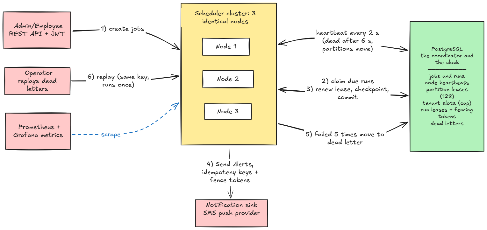
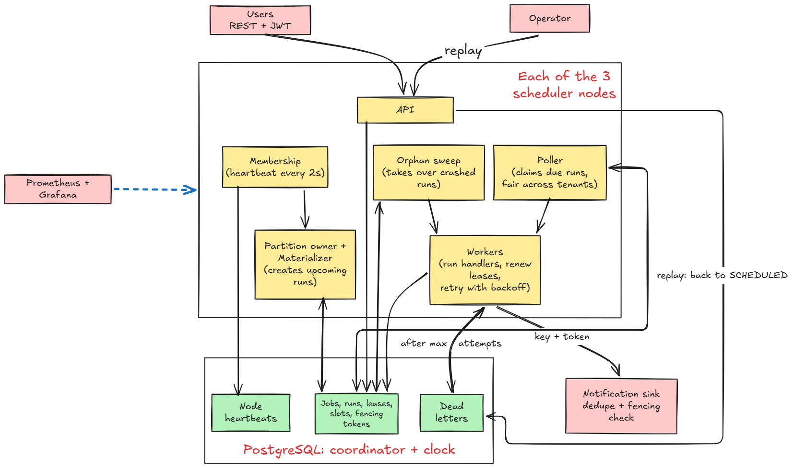
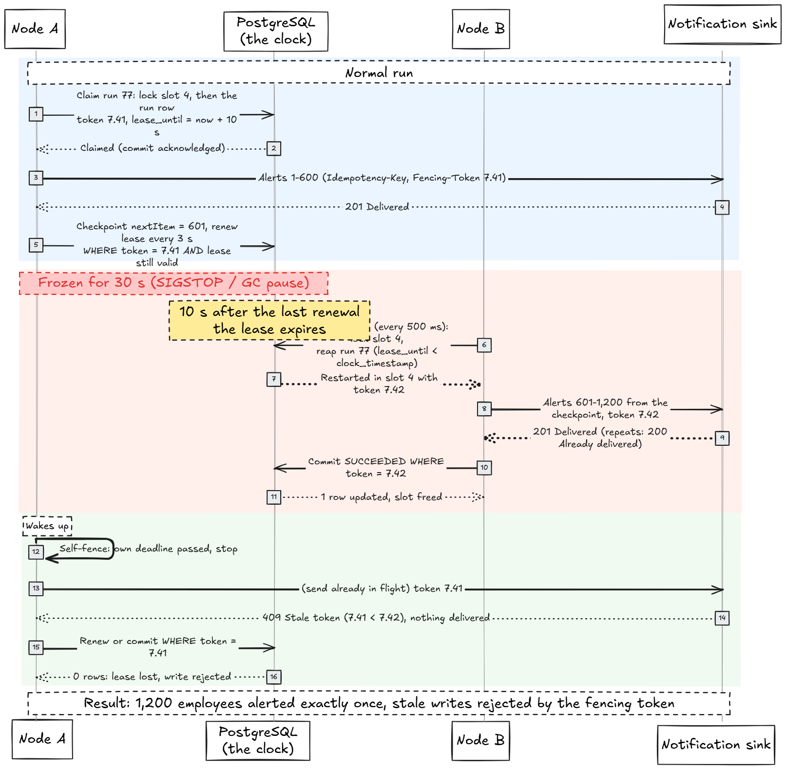

# Distributed Trip Job Scheduler

**Exactly-once effects across a cluster.** A scheduler for MoveInSync trip jobs:
- nightly rosters at 22:00 tenant time;
- "your cab is assigned" alerts 30 minutes before pickup;
- no-show auto-cancels;
- daily billing close.

It runs on three or more identical nodes with no leader. A node can be killed or frozen at any moment, and no job is lost and no job's effect happens twice.

> MoveInSync Backend Case Study 2026 · SDE Java Backend · **Case Study 3 · Advanced Track**
>
> Java 21 · Spring Boot 3.3 · PostgreSQL 16 · Docker Compose · Prometheus + Grafana


---

## Demo video

<!-- PLACEHOLDER:DEMO_VIDEO -->
> 🎥 **Demo video:** _link to be added_
>
> The video shows the main flows, a node killed and a node frozen while sending 1,200 alerts (handled live), and sample API calls. The script with exact commands is in [`docs/DEMO.md`](docs/DEMO.md).

---

## At a glance

| What the case study asks | Result |
|---|---|
| 100,000 jobs due in one 10-minute window, 3 nodes, p99 fire lag < 2 s | **p99 237 ms**, p50 108 ms, 0 duplicates |
| The same load with a node killed and another frozen for 30 s | **p99 291 ms** overall, 0 duplicates  |
| `kill -9` while sending 1,200 pickup alerts | Taken over in **7.6–8.0 s** (bound 10.7 s); 1,200 employees alerted **once each** |
| 30 s freeze (SIGSTOP), stale write rejected | Run finished on another node; the frozen node's writes **rejected by the fencing token** |
| 50,000 alerts from one tenant vs 20 from another | The 20 start within **185 ms** while the 50,000 drain at the tenant's cap |
| One-command run | `docker compose up --build`: 3 nodes, Postgres, sink, Toxiproxy, Prometheus, Grafana |

---

## Contents

1. [Requirements coverage](#1-requirements-coverage)
2. [Architecture](#2-architecture)
3. [Quick start](#3-quick-start)
4. [Job model: types, time zones and DST](#4-job-model-types-time-zones-and-dst)
5. [Firing correctly: exactly-once effect, leases, fencing, partitions](#5-firing-correctly-exactly-once-effect-leases-fencing-partitions)
6. [Misfires, retries and per-tenant fairness](#6-misfires-retries-and-per-tenant-fairness)
7. [Operations: controls and API](#7-operations-controls-and-api)
8. [The kill and freeze use cases](#8-the-kill-and-freeze-use-cases)
9. [Proof: the benchmark](#9-proof-the-benchmark)
10. [Plus points](#10-plus-points)
    - [Authentication and tenant isolation](#101-authentication-and-tenant-isolation)
    - [Cost estimation: time, space and where it stops scaling](#102-cost-estimation-time-space-and-where-it-stops-scaling)
    - [Handling system failure cases](#103-handling-system-failure-cases)
    - [Object-oriented design and layering](#104-object-oriented-design-and-layering)
    - [Trade-offs](#105-trade-offs)
    - [System monitoring](#106-system-monitoring)
    - [Caching](#107-caching)
    - [Error and exception handling](#108-error-and-exception-handling)
11. [Testing](#11-testing)
12. [Assumptions](#12-assumptions)
13. [Known limitations](#13-known-limitations)
14. [Repository layout](#14-repository-layout)
15. [Documents](#15-documents)

---

## 1. Requirements coverage

Every requirement in the case study, where it is handled and the automated proof. Click a section link for details.

### Case study requirements

| # | Requirement | How it is met | Proof | Details |
|---|---|---|---|---|
| I | One-off and cron jobs with tenant, payload, priority, max run time | `JobDefinition` (sealed: `OneOffJob`, `RecurringJob`); max run time is a hard stop | `JobDefinitionTest`, `JobValidationIT`, `MaxRunTimeIT` | [§4](#4-job-model-types-time-zones-and-dst) |
| I | Tenant time zones with DST (02:30 on spring-forward; 01:30 twice) | Gap → fires once at 03:00 local; overlap → fires once at the first 01:30 | `WallClockResolverTest`, `NextFireTimesTest`, `MaterializerIT` | [§4](#time-zones-and-daylight-saving-time) |
| II | Exactly-once **effect** (at-least-once execution + idempotency key) | Deterministic key per run and per item; unique constraint at the receiver | `ExactlyOnceEffectIT` (10,000 jobs, forced failures, 0 duplicates) | [§5](#exactly-once-execution-is-impossible-what-we-guarantee-instead) |
| II | Leases with fencing; a woken node cannot commit | 10 s run lease + `(epoch, seq)` token on every write, checked by DB and sink | `FencingIT`, `LeaseResurrectionIT`, `GcPauseIT`, `EndToEndFreezeIT` | [§5](#claim-fence-commit) |
| II | No single hot lock; partitions move on join/leave | 128 partitions, rendezvous hashing, a lease row per partition | `PartitionAssignerTest`, `RebalanceIT`, `ClaimRaceIT` | [§5](#no-single-hot-lock) |
| III | Misfire policy: fire now, skip, coalesce | Per job; a run that only waited behind its tenant's cap is not a misfire | `MisfirePolicyTest`, `MisfireIT`, `BurstSkipIT` | [§6](#misfires) |
| III | Per-tenant fairness and concurrency cap | Slot rows per tenant enforced by the schema; deficit round robin | `TenantFairnessIT`, `TenantCapIT`, `DrainRateIT` | [§6](#per-tenant-fairness) |
| III | Retries with exponential backoff + jitter, then dead-letter + replay | Full jitter, `maxAttempts`, operator replay with the same key | `BackoffPolicyTest`, `RetryToDeadLetterIT`, `ReplayMisfireIT` | [§6](#retries-and-the-dead-letter-list) |
| IV | Pause/resume a tenant, list next fire times, manual trigger | REST endpoints | `OpsApiIT`, `ApiIdempotencyIT` | [§7](#7-operations-controls-and-api) |
| IV | Fire-lag histogram; running, retrying and dead-lettered counts | `scheduler_fire_lag_seconds`, `scheduler_runs{state}` | `MetricsIT`, `EngineMetricsTest` | [§10.6](#106-system-monitoring) |
| Use case | `kill -9` during 1,200 alerts, each employee alerted once | Orphan sweep takes over in any partition from the checkpoint | `NodeCrashIT`, `EndToEndKillIT`, `NodeCrashBacklogIT`, `chaos/kill-during-alerts.sh` | [§8](#8-the-kill-and-freeze-use-cases) |
| Use case | 30 s SIGSTOP; stale write rejected | Self-fencing + fenced writes + the sink's highest-token check | `GcPauseIT`, `EndToEndFreezeIT`, `chaos/freeze-during-alerts.sh` | [§8](#8-the-kill-and-freeze-use-cases) |
| Key point | Why exactly-once execution is impossible | Explained, with what is guaranteed instead | — | [§5](#exactly-once-execution-is-impossible-what-we-guarantee-instead) |
| Key point | Which clock decides when a job is due | The PostgreSQL primary's `clock_timestamp()` | `FencingIT`, `ClaimRaceIT` | [§5](#which-clock-decides-when-a-job-is-due) |
| Key point | Fairness and partitioning numbers | Measured: 698 runs/s at cap 32, small tenant max 185 ms, partition split 39/40/49 | `TenantFairnessIT`, benchmark | [§6](#per-tenant-fairness), [§9](#9-proof-the-benchmark) |
| Key point | Prove it: 100k jobs in 10 min, p99 < 2 s, plus kill and freeze | `InProcessBench` + chaos scripts on Docker | p99 237 ms; chaos p99 291 ms | [§9](#9-proof-the-benchmark) |

### Plus points (overall evaluation criteria)

| # | Plus point | Summary | Details |
|---|---|---|---|
| 1 | Authentication, roles, tenant isolation | JWT with EMPLOYEE / ADMIN / OPERATOR; tenant from the token only; other tenants' rows return 404 | [§10.1](#101-authentication-and-tenant-isolation) |
| 2 | Cost estimation: time and space | Complexity per operation, measured knee at 900–1,000 runs/s, resource sizing | [§10.2](#102-cost-estimation-time-space-and-where-it-stops-scaling) |
| 3 | System failure cases | Crashes, freezes, timeouts, duplicates, out-of-order writes, partial failures; Toxiproxy + chaos scripts | [§10.3](#103-handling-system-failure-cases) |
| 4 | OOP and layering | Sealed hierarchies, ports and adapters, controller → service → repository, core logic in plain Java | [§10.4](#104-object-oriented-design-and-layering) |
| 5 | Trade-offs | Consistency over availability, latency vs DB load, caps vs throughput, and what was left out | [§10.5](#105-trade-offs) |
| 6 | System monitoring | 15 metric families, 13 alert rules with runbooks, Grafana dashboard, structured JSON logs | [§10.6](#106-system-monitoring) |
| 7 | Caching | Caffeine; exactly what can be stale and for how long; nothing correctness-critical cached | [§10.7](#107-caching) |
| 8 | Error handling, no PII | RFC 7807 problem details with stable codes; PII masked in logs, never in responses | [§10.8](#108-error-and-exception-handling) |

### Advanced Track

| Requirement | Where |
|---|---|
| Every hard rule has an automated test, including concurrency and failure tests | [§11](#11-testing): rule-to-test matrix (`ClaimRaceIT` with 32 threads, `SlotStealRaceIT`, `NodeCrashIT`, `EndToEndFreezeIT` …) |
| Measured performance: throughput, p50 / p99, machine | [§9](#9-proof-the-benchmark) |
| Design note: architecture diagram, sequence diagram of the hardest flow, failure-mode table | [§2](#2-architecture), [§10.3](#103-handling-system-failure-cases), [`docs/DESIGN.md`](docs/DESIGN.md) |
| One-command run | [§3](#3-quick-start): `docker compose up --build` |

---

## 2. Architecture

### Overview



The numbered steps in the diagram:
1. **Create.** Any node accepts API calls.
2. **Claim.** Nodes claim due runs from the partitions they own, one tenant slot per run.
3. **Run.** The node renews the lease, saves checkpoints and makes a fenced commit.
4. **Send.** Every alert carries an idempotency key and the fencing token.
5. **Dead-letter.** A run that fails 5 times becomes a dead letter.
6. **Replay.** An operator replays it with the same key, so it runs once.

Heartbeats every 2 s keep membership current. A node silent for 6 s is dead, and its partitions move.

Every node runs the same jar and there is **no leader**. PostgreSQL is the only coordinator and the only clock: partition leases, tenant slots, run leases and fencing tokens all live there. Nodes reach Postgres and the notification sink through Toxiproxy in compose, so one node can be cut off on its own.

### Inside a node



| Component | Interval | What it does |
|---|---|---|
| Membership | 2 s | Heartbeat into `scheduler_node`. A node is live if its heartbeat is under 6 s old (DB time) |
| Partition loop | 1 s | Computes owned partitions by rendezvous hashing over live nodes; acquires, renews (6 s lease, renewed every 2 s) or releases them |
| Materializer | 5 s | Creates `SCHEDULED` runs up to 15 minutes ahead (`UNIQUE (job_id, scheduled_at)` makes this safe to repeat) |
| Poller | 200 ms, plus on every finished run | Claims due runs from owned partitions, per tenant, one tenant slot per run. A freed slot is refilled within one round trip (at most 4 such claims at once per node) |
| Dispatcher | continuous | 64 virtual-thread workers per node, taking from tenant queues in turn (deficit round robin); recovered runs first, with 1 worker reserved for them |
| Lease renewer | 3 s | Extends each running run's 10 s lease with a fenced update |
| Orphan sweep | 500 ms | Takes over expired `RUNNING` runs in **any** partition and restarts them in the same slot |
| Slot compactor | 1 s | Finishes lowered caps (see [Changing a cap](#changing-a-cap)) |
| Purges | 10 min | Finished runs after 7 days, API idempotency records after 24 h |

### Hardest flow: node frozen mid-run, taken over, stale write rejected



1. Node A claims run 77 in slot 4 with token `7.41`, sends alerts 1–600 and saves checkpoint 601.
2. Node A is frozen (`docker pause`) for 30 s. Its lease expires 10 s after its last renewal.
3. Within 500 ms, node B's orphan sweep locks slot 4, reaps run 77 and restarts it in the same transaction and the same slot with token `7.42`. B sends alerts 601–1,200 from the checkpoint and commits.
4. Node A wakes up. Its monotonic deadline has passed, so it stops.
   - A send still in flight with token `7.41` gets `409 STALE_TOKEN` from the sink.
   - Any renewal or commit with token `7.41` updates zero rows.
   - If A was frozen inside a transaction, Postgres ended its session after 5 s idle, so A's row locks did not block B.
5. Result: 1,200 distinct deliveries, zero duplicates, and the tenant's running count never went above its cap (`EndToEndFreezeIT`).

### Run states

```
SCHEDULED → RUNNING → SUCCEEDED
              │  ├──► RETRY_WAIT → RUNNING        (failure or expired lease, new token)
              │  └──► DEAD_LETTERED → SCHEDULED   (operator replay, same row and key)
SCHEDULED → SKIPPED    (misfire SKIP / COALESCE)
SCHEDULED, RETRY_WAIT → CANCELLED   (job disabled)
```

Transitions are enforced by `RunStateMachine`. Pausing a tenant does not change run states: its runs stay `SCHEDULED`, and the claim skips the tenant. The claim reads `tenant.paused` directly, never from a cache.

---

## 3. Quick start

**Requirements:** Docker with Compose v2. To build and run the tests without Docker you need JDK 21 or newer; the wrapper downloads Maven.

```bash
docker compose up --build
```

| Service | Port | Purpose |
|---|---|---|
| `postgres` | 5432 | PostgreSQL 16: job store and the cluster's only clock. Runs with `idle_in_transaction_session_timeout=5s`, so a paused node cannot hold row locks for long |
| `scheduler-1`, `-2`, `-3` | 8081–8083 | Identical scheduler nodes, profiles `json,dev` |
| `notification-sink` | 8090 | Mock SMS/push provider that enforces idempotency keys and fencing tokens |
| `toxiproxy` | 8474 | Fault injection; each node reaches Postgres and the sink through its own proxy |
| `prometheus` | 9090 | Metrics and the 13 alert rules (firing alerts at http://localhost:9090/alerts) |
| `grafana` | 3000 | Dashboard at http://localhost:3000/d/scheduler-overview: anonymous read-only, or admin / admin |

Every service has a health check. `docker compose ps` shows when all are `healthy`.

> ⚠️ **This compose file is for a laptop only.**
> - It runs every node with the `dev` profile, which opens `POST /dev/token` on ports 8081–8083.
> - That endpoint mints an OPERATOR or ADMIN token for any tenant without authentication.
>
> Never expose the stack on a shared network. Outside a laptop:
> - drop `dev` from `SPRING_PROFILES_ACTIVE`;
> - set `SCHEDULER_JWT_HMAC_SECRET` and `SINK_ADMIN_TOKEN` to real secrets.
>
> A node without the `dev` (or `test`) profile refuses to start while the JWT secret is still the public default.

### First calls

An OPERATOR creates tenants, and an ADMIN of a tenant creates that tenant's jobs. The tenant always comes from the token.

```bash
# tokens (valid 1 hour, accepted by every node)
OP=$(curl -s -X POST localhost:8081/dev/token -H 'Content-Type: application/json' \
  -d '{"tenant":"platform","role":"OPERATOR"}' | jq -r .token)

curl -s -X POST localhost:8081/api/v1/tenants -H "Authorization: Bearer $OP" \
  -H 'Content-Type: application/json' -d '{"id":"acme","timeZone":"America/New_York","cap":32}'

ADMIN=$(curl -s -X POST localhost:8081/dev/token -H 'Content-Type: application/json' \
  -d '{"tenant":"acme","role":"ADMIN"}' | jq -r .token)

# a recurring roster job at 22:00 New York time
curl -s -X POST localhost:8081/api/v1/jobs -H "Authorization: Bearer $ADMIN" \
  -H 'Content-Type: application/json' -H 'Idempotency-Key: roster-blr-01' \
  -d '{"kind":"RECURRING","handler":"ROSTER_GEN","cron":"0 22 * * *",
       "payload":{"shiftDate":"2026-11-01","siteId":"BLR-01"},
       "maxRunTime":"PT5M","misfire":"COALESCE"}'

# a one-off pickup alert for three employees, 30 s from now (GNU date; macOS: date -u -v+30S +%FT%TZ)
RUN_AT=$(date -u -d '+30 seconds' +%FT%TZ)
JOB=$(curl -s -X POST localhost:8081/api/v1/jobs -H "Authorization: Bearer $ADMIN" \
  -H 'Content-Type: application/json' \
  -d '{"kind":"ONE_OFF","handler":"PICKUP_ALERT","runAt":"'"$RUN_AT"'","priority":1,
       "maxRunTime":"PT5M","misfire":"SKIP",
       "payload":{"employeeIds":["emp-0001","emp-0002","emp-0003"],
                  "messageTemplate":"Your cab arrives at {pickupTime}","pickupTime":"08:05"}}' | jq -r .id)

# after it ran: its run history, then the sink's exactly-once counters for that run
RUN=$(curl -s localhost:8081/api/v1/jobs/$JOB/runs -H "Authorization: Bearer $ADMIN" | jq -r '.items[0].runId')
curl -s "localhost:8090/api/v1/deliveries/stats?runId=$RUN"   # deliveredDistinct 3
curl -s localhost:8090/api/v1/deliveries/stats                 # maxDeliveriesPerKey 1

# run it again now: the Idempotency-Key header is required, a repeat returns the same run
curl -s -X POST localhost:8081/api/v1/jobs/$JOB/trigger -H "Authorization: Bearer $ADMIN" \
  -H 'Idempotency-Key: manual-1'
```

A Postman collection with these calls and more is in [`docs/postman/`](docs/postman/). The on-call guide is [`docs/RUNBOOK.md`](docs/RUNBOOK.md).

---

## 4. Job model: types, time zones and DST

### Job types

| Field | One-off | Recurring |
|---|---|---|
| Schedule | `runAt` (an instant) | `cron`: five fields (`minute hour day-of-month month day-of-week`), evaluated in the tenant's time zone |
| Common fields | `tenant` (from the token), `handler`, `payload` (JSON object ≤ 64 KiB), `priority`, `maxRunTime`, `misfire`, `misfireThreshold`, `maxAttempts` | same |

| Handler | Payload | What it does |
|---|---|---|
| `PICKUP_ALERT` | `{"employeeIds":[…],"messageTemplate":"…{employeeId}…{pickupTime}…","pickupTime":"08:05"}` | One alert per employee, in checkpointed chunks of 50 |
| `ROSTER_GEN` | `{"shiftDate":"2026-11-01","siteId":"BLR-01"}` | Generates tomorrow's roster |
| `NO_SHOW_CANCEL` | `{"tripId":"T-1001","employeeId":"e42"}` | Auto-cancels a no-show |
| `BILLING_CLOSE` | `{"period":"2026-10","accountId":"ACME"}` | Closes daily billing |

The API checks only that the payload is a JSON object. A payload the handler cannot read is dead-lettered on its first attempt as `INVALID_PAYLOAD`.

**Max run time is a hard stop.**
- At `maxRunTime` the handler is interrupted and further effects are refused. The attempt fails with `TIMEOUT` and goes through the normal retries.
- A handler that returns anyway is still a `TIMEOUT`, never a success.
- A handler that ignores the interrupt is abandoned 3 s later: the engine records `TIMEOUT` with the run's fenced commit, which frees its slot (`MaxRunTimeIT`).

### Time zones and daylight saving time

Cron expressions match **local wall time in the tenant's zone**. They are parsed by our own `CronSchedule` (Vixie cron day matching), and `WallClockResolver` maps each local time to exactly one instant.

| Case | Example (America/New_York) | Rule | Fires at |
|---|---|---|---|
| Clocks jump 02:00 → 03:00 | 8 Mar 2026, job at 02:30 | Fires once at **03:00 local**, when the skipped hour ends, as classic cron does (Java's default would be 03:30) | 07:00Z |
| 01:00–01:59 happens twice | 1 Nov 2026, job at 01:30 | Fires **once, at the first 01:30** (EDT, −04:00) | 05:30Z |
| Sub-hourly job in the repeated hour | `*/15 * * * *` | Each distinct local time fires once: 4 runs in the repeated hour, not 8 | — |
| Zone without DST | Asia/Kolkata, 22:00 | Direct mapping | 16:30Z |

`GET /api/v1/jobs/{id}/next-fire-times?count=N` shows each instant with its local time and offset, so the DST behaviour can be checked through the API.

---

## 5. Firing correctly: exactly-once effect, leases, fencing, partitions

### Exactly-once execution is impossible: what we guarantee instead

A node can send an alert and then die before it records the send. To the rest of the cluster that looks exactly like a node that died before sending. A node in a 30-second GC pause also looks the same as a dead one. So a scheduler has two options:
- retry, and maybe repeat the work;
- never retry, and maybe lose it.

Losing jobs is not allowed, so this scheduler retries. **What it guarantees instead:**

- **At-least-once execution.** Every scheduled occurrence is executed at least once.
- **Exactly-once effect.**
  - Every run has a deterministic idempotency key: `{jobId}:{scheduledAtUtc}`, or `{jobId}:manual:{Idempotency-Key}` for a manual run.
  - Every item inside a run has its own key: `{runKey}:{employeeId}`.
  - The receiver stores keys under a unique constraint and answers repeats with `200 ALREADY_DELIVERED`.
- **A node whose lease expired can write nothing.**
  - No renewal, no checkpoint, no commit, even if nobody has taken the run over yet.
  - Every state change carries a fencing token `(epoch, seq)`, and both the database and the sink reject outdated tokens.
- **Across a PostgreSQL failover**, no acknowledged write is lost and tokens never go backwards, as long as the [failover requirements](#failover-requirements-production) hold. If they can't be met, writes stop rather than continue unprotected.

This relies on downstream systems honouring idempotency keys, or on a dedupe table we control in front of them. No scheduler can make a non-idempotent third-party API exactly-once.

### Which clock decides when a job is due

**The PostgreSQL primary's clock.**
- Due-time and lease checks are SQL predicates on `clock_timestamp()`. We don't use `now()`, which is the transaction's start time and could call an expired lease valid.
- Node clocks affect only log timestamps.
- Each node uses its monotonic clock only to stop itself early when it hasn't renewed a lease in time, and clock skew does not move a monotonic clock.

### No single hot lock

- **Partitions.** Jobs are split into **128 fixed partitions** (`murmur3(jobId) % 128`), each with its own lease row, so nodes contend per partition and never on one global lock row.
- **Join or leave.** When a node joins or leaves, only the partitions that hash to it move (about `128 / N`).
- **Balance.** With the compose node ids the split is 39 / 40 / 49. Rendezvous hashing balances statistically, not exactly: max/min is about 1.3 (mean 1.31 over 10,000 random 3-node sets).
- **Correctness doesn't depend on ownership.** If two nodes poll the same partition during a handover, `FOR UPDATE SKIP LOCKED` and the run-level fencing token still allow only one claim per run (`ClaimRaceIT`, 32 threads).
- **Handover time.** When a partition's lease expires, its previous owner is treated as dead for that partition at once, and another node picks it up within about 7 s (`RebalanceIT`).
- **Running jobs don't wait for the handover.** The orphan sweep takes over expired runs in any partition.

**Takeover bound: ≤ 10.7 s after a crash.** That is the 10 s run lease after its last renewal, plus up to 0.5 s for the sweep, plus about 0.2 s for the claim.
- Measured: 9.99–10.15 s in `NodeCrashIT` and 7.6–8.2 s in `EndToEndKillIT`.
- The same holds while the tenant has a backlog: 10.0 s with 300 older due runs waiting (`NodeCrashBacklogIT`).
- The tests assert ≤ 11.2 s, which is also the alert threshold.

### Claim, fence, commit

All engine writes to run state and slots go through one class, `JdbcClaimProtocol`.

1. **Claim.** One transaction, always locking the slot row first and the run row second:
   - Lock a free-looking slot of the tenant below its cap (`FOR UPDATE SKIP LOCKED`).
   - If the slot still has a holder whose lease looks expired, **reap it with a conditional update**: `… SET state = 'RETRY_WAIT' WHERE id = ? AND state = 'RUNNING' AND lease_until < clock_timestamp()`.
     - One row updated: the reaped run is restarted at once in that slot.
     - Zero rows: the holder renewed in time.
     - The reap and a renewal update the same row, so exactly one of them succeeds.
   - Start the most urgent due run (`ORDER BY priority, due_at`): `RUNNING`, a slot, token `(epoch, nextval('fence_seq'))`, `lease_until = clock_timestamp() + 10 s`. The token is used only after this transaction commits.
2. **Execute.**
   - Every outbound call carries an `Idempotency-Key` and `Fencing-Token: <epoch>.<seq>`.
   - The renewer extends the lease every 3 s with `WHERE id = ? AND (fencing_epoch, fencing_seq) = (?, ?) AND state = 'RUNNING' AND lease_until >= clock_timestamp()`, so **an expired lease can never be renewed**.
3. **Checkpoint.** Chunked handlers save `{"nextItem": n}` after each chunk of 50, using the same fenced predicate.
4. **Commit.**
   - Same predicate, setting `SUCCEEDED` and freeing the slot in one statement.
   - Zero rows means the lease was lost. The commit is rejected and counted (`scheduler_stale_commit_rejected_total`).
   - Commits never lock slot rows, so claims and commits can't deadlock (`LockOrderIT`).

### Fencing tokens

- **Comparison.** A token is `(fencing_epoch, fencing_seq)`, compared epoch first. There is no bit packing, so there is no range limit.
- **Epoch.** `fencing_epoch = cluster_generation × 2^32 + timeline`. PostgreSQL's timeline rises on every promotion, so a new primary's tokens beat all of the old one's. If the timeline can't be read, the claim fails and nothing starts.
- **Rebuilds.** Operators raise `cluster_generation` when rebuilding from a fresh `initdb`. Nodes refuse to start if their epoch is below the sink's highest accepted epoch (`EpochGuardIT`).
- **Lease loss.**
  - A `409 STALE_TOKEN` means the lease was lost: the handler stops and the attempt doesn't count toward `maxAttempts`.
  - After 20 lease losses the run is dead-lettered as `FENCING_CONFLICT`, which raises an alert.

---

## 6. Misfires, retries and per-tenant fairness

### Misfires

A run has **misfired** when it was already more than `misfireThreshold` past its scheduled time at the moment its tenant last became claimable. The default threshold is 60 s and the maximum is 7 days. Examples: after cluster downtime, a database outage, or a tenant pause.

- **Queueing is not a misfire.** A run that merely waited behind its own tenant's cap is late but has not misfired, so a large `SKIP` burst runs in full (`BurstSkipIT`).
- **"Became claimable"** is the later of two times:
  - the tenant's last unpause (`tenant.resumed_at`);
  - the start of the live nodes' unbroken heartbeats (`scheduler_node.alive_since`).

Each job picks a policy (default `FIRE_NOW`):

| Policy | After 3 missed hourly runs | Typical use |
|---|---|---|
| `FIRE_NOW` | All 3 run now, in order | Billing close: every period must close |
| `SKIP` | All 3 skipped; the next run is normal | Pickup alerts: a late alert is useless |
| `COALESCE` | The newest runs once with `coalescedCount = 3`; the others are skipped | Roster generation: only the latest matters |

Replays and manual triggers are explicit requests to run, so they are exempt from the misfire policy (`ReplayMisfireIT`).

### Retries and the dead-letter list

- **Backoff.** Exponential with full jitter: `delay = random(0, min(5 min, 2 s × 2^attempt))`.
- **Retried:**
  - sink 5xx (`SINK_5XX`);
  - timeouts (`SINK_TIMEOUT`);
  - the max-run-time stop (`TIMEOUT`).
- **Dead-lettered at once:** unreadable payloads (`INVALID_PAYLOAD`) and other sink 4xx (`SINK_REJECTED_<status>`).
- **After `maxAttempts`** (default 5, up to 100), the run is dead-lettered.
- **Inspect and replay.**
  - An operator lists dead letters: error code and counts only, never payload data.
  - A replay sends the **same run row and idempotency key** back to `SCHEDULED`, so items delivered before the failure are not sent again.
  - Replaying twice returns `409 DEAD_LETTER_ALREADY_REPLAYED`.

### Per-tenant fairness

- **Slots.** Each tenant has a cluster-wide concurrency cap (default 32), enforced by **slots**: exactly `cap` rows in `tenant_slot`. A run can only be `RUNNING` while it holds one.
- **Dispatch.** The dispatcher takes from tenant queues in turn (deficit round robin), so one tenant's backlog never blocks another tenant.

Scenario: 3 nodes × 64 workers, both tenants' alerts due at the same instant, each alert a 20–60 ms sink call (`TenantFairnessIT`, [`docs/BENCHMARK.md`](docs/BENCHMARK.md) §3.2).

| | Without caps (one FIFO queue), *estimate* | With caps (32 per tenant), **measured** |
|---|---|---|
| Tenant A, 50,000 alerts | drains in ≈ 10.4 s | **698 runs/s, drained in 71.6 s** |
| Tenant B, 20 alerts | waits up to 10.4 s ❌ | **max lag 185 ms** ✅ |

Each run holds its slot for about 46 ms (sink call + checkpoint + fenced commit + the claim that refills the slot), so 32 slots ≈ 700 runs/s. A hard cap leaves capacity idle during a single-tenant burst: we chose isolation over peak throughput.

#### Why the cap always holds

The database enforces it, with no tolerance even during partition moves or crashes:

- A running run must hold a slot: `CHECK (state <> 'RUNNING' OR (slot_no IS NOT NULL AND fencing_seq IS NOT NULL))`.
- The slot must be a real slot of the same tenant: composite foreign key `(tenant_id, slot_no) → tenant_slot`.
- No slot is used twice: `UNIQUE (tenant_id, slot_no) WHERE state = 'RUNNING'`.
- A slot passes to a new run only after the old run is reaped by a conditional update.

`TenantCapIT` samples the running count every 10 ms through random kills, freezes and partition moves. `SchemaIT` shows the database itself rejects every violation.

#### Changing a cap

- **Raising** a cap adds slot rows at once.
- **Lowering** a cap is deferred:
  - Free high slots are deleted immediately.
  - Running runs drain into lower slots through the compactor.
  - No new run starts until the running count is below the new cap (`CapReductionIT`).
  - Running jobs are never stopped.
- `PUT /tenants/{t}/cap` returns `configuredCap`, `effectiveCap` and `draining`.

---

## 7. Operations: controls and API

All endpoints are under `/api/v1` and need a bearer token. A wrong role gets `403 FORBIDDEN`; a missing or bad token gets `401 UNAUTHORIZED`.

| Method and path | Purpose | Roles | `Idempotency-Key` |
|---|---|---|---|
| `POST /tenants` | Create a tenant: `{"id","timeZone","cap"}` | OPERATOR | ignored (a repeat gets `409 TENANT_EXISTS`) |
| `POST /jobs` | Create a one-off or recurring job (201) | ADMIN | optional |
| `GET /jobs/{id}` | Job definition; payload only for ADMIN | ADMIN, EMPLOYEE, OPERATOR | — |
| `GET /jobs/{id}/next-fire-times?count=10` | **Next 1–100 fire times** with local time and offset | ADMIN, EMPLOYEE | — |
| `POST /jobs/{id}/trigger` | **Manual trigger** (202); a repeat returns the same run | ADMIN, OPERATOR | **required** |
| `DELETE /jobs/{id}` | Disable a job and cancel its unstarted runs | ADMIN | — |
| `GET /jobs/{id}/runs?page=0&size=50` | Run history: state, attempt, lag, error code | ADMIN, OPERATOR | — |
| `POST /tenants/{t}/pause` · `/resume` | **Pause or resume all of a tenant's jobs** | ADMIN (own tenant), OPERATOR | optional |
| `PUT /tenants/{t}/cap` | Change the concurrency cap | ADMIN (own tenant), OPERATOR | optional |
| `GET /dead-letters?tenant=&page=&size=` | **Inspect** dead-lettered runs | OPERATOR, ADMIN (own) | — |
| `POST /dead-letters/{runId}/replay` | **Replay** with the same idempotency key | OPERATOR | optional |
| `GET /cluster` | Live nodes, partitions per node, each partition's owner and epoch | OPERATOR | — |

**Retry-safe writes.**
- With an `Idempotency-Key`, the action and its stored response commit in one transaction.
- A retry gets the original status and body with `Idempotent-Replayed: true`, and nothing runs a second time.
- Reusing a key with a different request is `409 IDEMPOTENCY_KEY_REUSED`.
- Keys are namespaced per tenant and honoured for 24 hours.

The sink's own API is in [`docs/sink-api.md`](docs/sink-api.md). The metrics the case study asks for are in [§10.6](#106-system-monitoring).

---

## 8. The kill and freeze use cases

Both use cases are covered three ways: an in-JVM test, an end-to-end test against the real sink over HTTP, and a chaos script against the Docker stack.

| Use case | Tests | Docker result (2026-10-30) |
|---|---|---|
| `kill -9` while sending 1,200 pickup alerts | `NodeCrashIT` (kill right after a lease renewal, the worst case), `EndToEndKillIT`, `NodeCrashBacklogIT` (kill while the tenant has a 300-run backlog) | **PASS:** taken over 7.98 s after the kill with a higher token; 1,200 distinct deliveries; re-sent items absorbed as `ALREADY_DELIVERED`; max 1 delivery per key |
| Node frozen for 30 s (SIGSTOP); stale write rejected | `GcPauseIT`, `EndToEndFreezeIT` (in-flight send gets 409, commit rejected), `LeaseResurrectionIT` | **PASS** (twice): the run finished on another node; the frozen node's fenced write matched 0 rows (`scheduler_lease_lost_total{reason="fenced_write_0_rows"}` 0 → 1); 1,200 delivered once |

Run them yourself on the compose stack (they need `jq`; see [`chaos/README.md`](chaos/README.md)):

```bash
bash chaos/kill-during-alerts.sh     # ends with RESULT: PASS, the takeover time and token change
bash chaos/freeze-during-alerts.sh   # ends with RESULT: PASS and the fencing counters before/after
```

---

## 9. Proof: the benchmark

`InProcessBench` (in `loadgen`, test scope) runs:
- three real scheduler nodes in one JVM with production settings: 64 workers, 200 ms poll, 10 s run lease, 500 ms sweep;
- the real notification sink over HTTP in a second JVM, adding 20–60 ms to every delivery to simulate provider I/O;
- PostgreSQL with `fsync`, `synchronous_commit` and `full_page_writes` on.

```bash
# one scenario per run: spread | burst | chaos | ramp | all   (about 12 minutes per 100k scenario)
./mvnw -B -pl loadgen -am verify -Pbench -Dtest=none -Dsurefire.failIfNoSpecifiedTests=false \
  -Dit.test=InProcessBench -Dfailsafe.failIfNoSpecifiedTests=false -Dbench.scenario=spread
```

The run fails on any duplicate or unfinished run. Knobs and a 5-minute smoke run are in [`docs/BENCHMARK.md` §2](docs/BENCHMARK.md#2-how-to-run-it).

**Target:** 100,000 jobs due in one 10-minute window on 3 nodes, p99 fire lag under 2 s. **Met: p99 237 ms.**

| Scenario | Runs | Throughput | p50 lag | p99 lag | Max lag | Duplicates |
|---|---|---|---|---|---|---|
| Spread: 100,000 jobs, 50 tenants, 10 min | 100,000 | 166.6 runs/s (the arrival rate) | 108 ms | **237 ms** | 849 ms | **0** |
| Burst: tenant B (20 alerts) during A's 50,000 | 20 | — | 142 ms | 185 ms | **185 ms** | **0** |
| Burst: tenant A, 50,000 at once, cap 32 | 50,000 | 698 runs/s, drained in 71.6 s | 36.2 s | 70.8 s | 71.6 s | **0** |
| Spread + chaos: kill at 4 min, 30 s freeze at 7 min | 100,000 | same arrivals as spread | 109 ms | **291 ms** | 7.2 s | **0** |

**Machine:**
- **Hardware:** Intel Core i7-10750H laptop (6 cores / 12 threads), 16 GiB DDR4-2933, 1 TB NVMe SSD (Intel 660p, QLC).
- **OS:** Windows 11 Home Single Language 10.0.26200.
- **Java:** HotSpot 22.0.2 (code built with `--release 21`).
- **JVMs:** benchmark JVM `-Xmx4g -Xms1g -XX:+UseG1GC`, shared by the 3 nodes; sink JVM `-Xmx768m`.
- **Database:** PostgreSQL 16.15, `shared_buffers=512MB`, `fsync=on`, `synchronous_commit=on`.

### The chaos run, honestly

Across the whole 10 minutes, p99 stayed at 291 ms and nothing was lost or duplicated:
- 100,000 distinct deliveries;
- 17 orphan takeovers;
- 5 re-sends absorbed as `ALREADY_DELIVERED`;
- 17 stale sends from the thawed node rejected with 409.

But the 2 s target is **missed for runs that fall due in the dead or frozen node's partitions in the seconds after the event**:

| Window (runs scheduled in the 60 s after the event, in the victim's partitions) | Runs | p99 | Max |
|---|---|---|---|
| After the kill | 3,410 | 3.7 s | 4.4 s |
| After the 30 s freeze | 5,345 | 5.3 s | 7.2 s |
| Unaffected partitions, whole run | 30,377 | 240 ms | 1.3 s |

The cause is partition handover, not takeover: new runs in a dead node's partitions wait until its 6 s partition lease expires. Runs that are already running are taken over by the orphan sweep regardless of partitions. A shorter partition lease would shrink this window, at the cost of more lease traffic. Full tables are in [`docs/BENCHMARK.md` §3.3](docs/BENCHMARK.md#33-scenario-3-spread--chaos-p99-291-ms-overall-0-duplicates-p99-in-the-affected-window-37-s-kill-and-53-s-freeze).

---

## 10. Plus points

### 10.1 Authentication and tenant isolation

- **Roles.**
  - EMPLOYEE reads the schedules of their own tenant.
  - ADMIN manages one tenant's jobs, pause, resume and cap.
  - OPERATOR is the platform on-call role. It creates tenants and works across tenants, but only on operational data (states, counts, error codes), never payloads.
  - The matrix is tested endpoint by endpoint (`RoleMatrixIT`).
- **Tenant isolation.**
  - The tenant comes only from the token, never from the request body or path.
  - Every repository query takes a `TenantScope` and adds a tenant predicate.
  - Another tenant's job, tenant or dead letter returns **`404`**, not `403`, and nothing changes (`TenantIsolationIT`).
- **Tokens.**
  - HS256 JWTs with `roles` and tenant claims, validated by Spring Security's resource server.
  - The secret is `SCHEDULER_JWT_HMAC_SECRET` (at least 32 characters). A node outside the `dev`/`test` profiles refuses to start with the public default (`JwtSecretGuardTest`).
  - `/dev/token` exists only in the `dev` profile (`DevTokenIT`, `DevTokenDisabledIT`). In production, tokens would come from an identity provider.
- **Sink admin API.** The sink's fault-injection API needs `X-Admin-Token`.

### 10.2 Cost estimation: time, space and where it stops scaling

**Time and space complexity:**

| Operation | Time | Space |
|---|---|---|
| Claim (per poll) | O(T · log R + b): T tenants with due runs, R due runs in owned partitions (partial index), b claimed rows | O(b) |
| Node memory | — | O(workers + batch), **not** O(jobs) |
| Partition assignment | O(P · N) hashes per membership change (128 × 3 = 384) | O(P) |
| Materialisation | O(occurrences in the next 15 minutes) | one `job_run` row per occurrence |
| Storage | — | one `job_run` row per run, kept for 7 days after it finishes; one sink row per delivered item |

**Measured capacity:**

| Quantity | Value | Basis |
|---|---|---|
| Arrival rate for the target | 167 runs/s | 100,000 / 600 s; measured p99 237 ms |
| Knee (p99 > 2 s) | **900–1,000 runs/s** | Ramp on this laptop, about 5.5× the target rate |
| State transitions at the knee | about 2,700–3,000 /s | 3 per run: claim, checkpoint, commit |
| Single-tenant drain at cap 32 | 614–698 runs/s | `DrainRateIT`, burst benchmark |
| Takeover after `kill -9` | ≤ 10.7 s bound | `NodeCrashIT` 9.99–10.15 s |
| New runs in a dead node's partitions | up to about 7 s | 6 s partition lease + 1 s loop |

**Where it stops scaling.**
- On this laptop, p99 crosses 2 s between 900 and 1,000 runs/s. Above that, nothing fails or duplicates: runs queue and lag grows.
- The bottleneck was not isolated, because the scheduler JVM, the sink JVM and Postgres share 6 cores, and CPU hit 91–100 %.
- The leading hypothesis is the poller. Each node claims tenant by tenant on a single thread, so with 50 tenants that is up to 50 claim transactions per 200 ms tick.
- Next steps:
  - if the poller is the limit, claim several tenants per transaction or in parallel;
  - if Postgres is the limit, shard by partition range.
- 128 partitions also caps the useful node count at about 40.

**Resource estimate for the target load.** Prices are left out on purpose; multiply by your provider's rates.

| Component | Sizing | Reasoning |
|---|---|---|
| Scheduler nodes | 3 × (2 vCPU, 2–4 GB) | The whole laptop averaged 15 % of 12 threads during the spread run; 3 nodes are the minimum for the failure model, not for throughput |
| PostgreSQL | 1 primary + 2 standbys, about 4 vCPU and 8–16 GB each, SSD | One synchronous standby for durability; the third lets Patroni promote and keep one |
| Patroni coordination | 3 small etcd members | Leader lease and the synchronous-standby record |
| Monitoring | 1 small Prometheus + Grafana | 4 scrape targets every 5 s |

The dominant cost is the replicated Postgres, which is the price of the exactly-once and failover guarantees.

### 10.3 Handling system failure cases

**Failure-mode table** (with detection and the test for each row: [`docs/DESIGN.md` §4](docs/DESIGN.md#4-failure-modes)):

| What fails | What users see | How it recovers |
|---|---|---|
| Node killed mid-run | Alerts pause ≤ 10.7 s, then continue; nobody gets two | Lease expires; another node restarts the run in the same slot with a higher token from the checkpoint; the sink drops repeats |
| Node frozen (GC pause, `docker pause`) | Same as a kill | Node stops itself on wake-up; sink and DB reject its old token; a session frozen inside a transaction is ended after 5 s |
| Node lost, partitions orphaned | New due runs in those partitions wait up to about 7 s | Partition leases (6 s) expire and live nodes take them over |
| Renewal and slot reuse at the same moment | Nothing | Both update the same row; exactly one succeeds |
| PostgreSQL unreachable | No jobs fire; API returns `503 SCHEDULER_STORE_UNAVAILABLE` | Nodes stop starting work; misfire policies handle the backlog when it returns |
| PostgreSQL primary fails (production) | Writes pause about 10–30 s; nothing acknowledged is lost | Patroni promotes only the synchronous standby; the new timeline raises the token epoch |
| Notification sink down or slow (timeouts) | Alerts delayed, retry count rises | Backoff with jitter, then dead letter; operator replays; caps contain it to one tenant |
| Duplicate messages (re-sent chunk, double-clicked trigger, client retry) | One effect | Idempotency keys at the sink and at the API |
| Out-of-order or late messages | Nothing | Every write is conditional on the token and state; the sink rejects lower tokens |
| Partial failure (some alerts sent, then crash) | Remaining alerts arrive after the takeover | Checkpoints per chunk; the new owner resumes from the checkpoint; re-sent items are deduplicated |
| Clock skew on a node | Nothing | Due times and leases use the database clock |
| Bad payload | Run in the dead-letter list as `INVALID_PAYLOAD` | Dead-lettered at once |
| Admin lowers a cap below the running count | New starts for that tenant wait | Deferred reduction; running stays ≤ the effective cap |
| Cluster rebuilt from a fresh `initdb` | Nodes refuse to start | Operator raises `cluster_generation` |

**Failure-injection tests:**
- **Toxiproxy** in compose: a proxy per node to Postgres and to the sink.
- **Sink fault API:** latency with jitter and random 500/503 failures (`FaultInjectionIT`, `RetryToDeadLetterIT`). "Failed after the send" cases are forced in-process by `ExactlyOnceEffectIT`.
- **Chaos scripts:** kill and freeze on Docker ([§8](#8-the-kill-and-freeze-use-cases)).

#### Failover requirements (production)

We rely on Patroni with etcd for database failover and treat these as preconditions ([`deploy/patroni/README.md`](deploy/patroni/README.md) maps each one to a setting):

| # | Requirement | How it is met |
|---|---|---|
| F1 | Every acknowledged commit is on at least one standby | `synchronous_commit = on` |
| F2 | The primary never falls back to asynchronous replication | `synchronous_mode: true` + `synchronous_mode_strict: true`; writes block without a standby |
| F3 | Only a replica holding every acknowledged commit can be promoted | 1 primary + 2 standbys with `FIRST 1`; Patroni promotes only the recorded synchronous standby |
| F4 | The old primary can't accept writes after a promotion | Leader lease + watchdog; JDBC `targetServerType=primary` |
| F5 | Fencing epochs strictly increase | New timeline on every promotion + `cluster_generation` + startup check against the sink |

### 10.4 Object-oriented design and layering

**Core logic in plain classes.**
- `scheduler-core` is plain Java with no Spring and no database. It holds cron and DST resolution, misfire and backoff policies, partition assignment, fairness, the lease clock and the run state machine.
- It has 322 unit tests that run in seconds without a web server or database.

**Layering in `scheduler-app`:**

```
api/          controllers (JobController, TenantController, DeadLetterController, JobRunController, ClusterController)
   ↓
service/      business rules (JobService, TenantService, DeadLetterService, RunService, IdempotencyService …)
   ↓
repository/   SQL only (claim/, job/, tenant/, deadletter/, cluster/, idempotency/), every query takes a TenantScope
engine/       the scheduling loops (SchedulerNode, Poller, Dispatcher, OrphanSweep, RunExecutor …)
handler/      job handlers, one class per job type
```

**Encapsulation.**
- All run-state and slot writes of the engine go through one class, `JdbcClaimProtocol`, which owns the locking order and the fenced predicates.
- `FencingToken`, `TenantId` and `RunStateMachine` are value types or guarded objects, so invalid states can't be built.

**Inheritance:**

| Base | Subclasses |
|---|---|
| `PeriodicLoop` | `Poller`, `OrphanSweep`, `PartitionLoop`, `MembershipLoop`, `SlotCompactor`, `TaskLoop` |
| `JobHandler` → `ChunkedJobHandler` | `PickupAlertHandler` (chunked + checkpointed), `RosterGenerationHandler`, `NoShowCancelHandler`, `BillingCloseHandler` |
| `SchedulerException` (sealed) | `NotFoundException`, `ConflictException`, `ForbiddenException`, `ValidationException`, `StoreUnavailableException` |

**Polymorphism.**

| Abstraction | Implementations |
|---|---|
| `MisfirePolicy` (sealed) | `FireNow`, `Skip`, `Coalesce`, selected per job by `MisfirePolicy.of(type)` |
| `JobDefinition` (sealed) | `OneOffJob`, `RecurringJob` |
| `BackoffPolicy` | `ExponentialFullJitterBackoff` |
| `HandlerRegistry` | dispatches a run to its handler by type |

**Ports and adapters.** The engine depends on interfaces, so the core runs against in-memory fakes in tests and against PostgreSQL in production:

| Port | Production adapter |
|---|---|
| `ClaimProtocol` | `JdbcClaimProtocol` |
| `PartitionLeaseStore` | `JdbcPartitionLeaseStore` |
| `MembershipStore` | `JdbcMembershipStore` |
| `EffectSink` | `HttpEffectSink` |
| `SchedulerClock` | `DbSchedulerClock` |

### 10.5 Trade-offs

**Consistency vs availability vs latency:**
- **Consistency over availability.** If the database is unreachable, nothing fires. Firing from local state could fire twice.
- **Durability over availability on failover.** Strict synchronous replication blocks writes when no standby is available. Each commit pays about one LAN round trip (*estimate* ≈ 1 ms).
- **Latency vs database load.** A 200 ms poll keeps lag around 100 ms, but claim load grows with tenants and throughput. LISTEN/NOTIFY could cut lag further.

**Other trade-offs:**
- **PostgreSQL vs etcd, ZooKeeper or Kafka.** We chose one dependency, transactional state and a single trusted clock, and accepted a write ceiling ([§10.2](#102-cost-estimation-time-space-and-where-it-stops-scaling)).
- **Hard caps vs throughput.** Caps leave capacity idle during single-tenant bursts, in exchange for isolation.
- **Exact caps vs write cost.** Slot rows enforce the cap exactly, at the cost of one slot-row lock per run start.
- **Lease length.**
  - A 10 s run lease means a 10.7 s takeover. A shorter lease takes over faster but causes more false takeovers during GC pauses.
  - The 6 s partition lease is what new runs in a dead node's partitions wait for.
- **Strict lease expiry.** A write after the lease expired is rejected even if nobody took over. That costs an occasional deduplicated rerun and makes slot reuse race-free.
- **Deferred cap reduction.** Lowering a cap never stops running jobs.
- **In-process cache vs Redis.** Nothing correctness-critical is cached ([§10.7](#107-caching)).

**Left out on purpose:**
- multi-region scheduling;
- exactly-once effects against APIs that ignore idempotency keys;
- job dependencies or DAGs;
- fixed-rate schedules and sub-second precision;
- an admin UI;
- real SMS and push providers;
- a full OAuth2 identity provider;
- our own failover manager (Patroni is relied on).

### 10.6 System monitoring

- **Scraping.** Metrics are at `/actuator/prometheus` on every node and on the sink, and Prometheus scrapes all four every 5 s.
- **Dashboard.** Grafana provisions the "Trip Job Scheduler" dashboard.
- **Alerts.** **13 alert rules** in [`ops/prometheus/alerts.yml`](ops/prometheus/alerts.yml), each with a `runbook_url` into [`docs/RUNBOOK.md`](docs/RUNBOOK.md).

| Metric | What on-call learns at 3 AM | Alert |
|---|---|---|
| `scheduler_fire_lag_seconds` (histogram, by `handler`, `tenant_tier`) | **Fire lag**: actual start minus scheduled time, DB clock | p99 > 2 s for 5 min |
| `scheduler_runs{state}` | **Running, retrying and dead-lettered counts** | Any new dead letters |
| `scheduler_queue_depth` | **Queue depth**: runs due but not started | Rising for 2 min |
| `scheduler_run_outcome_total{outcome}` | **Error rate**: success, retryable, permanent, timeout | Error rate > 5 % for 5 min |
| `scheduler_tenant_cap_rejections_total{tenant}` | **Rejections**: claims held back by tenant caps | Informational |
| `scheduler_stale_commit_rejected_total` | Fenced commits that matched nothing (GC pauses, splits) | Any increase |
| `scheduler_lease_lost_total{reason}` | `stale_409`, `fenced_write_0_rows`, `self_fence` | > 5 for one reason in 5 min |
| `scheduler_dead_letters_total{error_code}` | Dead letters by error code | Any `FENCING_CONFLICT` in 15 min |
| `scheduler_lease_renew_failures_total` | A node losing its leases | Any in 2 min |
| `scheduler_orphan_takeover_time_seconds` | Time from the dead owner's last renewal to the takeover | p99 > 11.2 s |
| `scheduler_partitions_owned{node}` | Partition spread | Total ≠ 128 for 10 s |
| `scheduler_claim_batch_seconds` | Claim transaction latency | p99 > 100 ms for 5 min |
| `scheduler_tenant_cap{tenant,kind}` | Configured vs effective cap | Draining for 30 min |
| `up` | A node or the sink not scraped | 30 s |
| `sink_deliveries_total{outcome}` | What the provider saw: delivered, duplicate, stale token, fault | — |

**Structured logging.**
- Logs are JSON lines.
- Request lines carry `traceId` and `tenantId`.
- Lines written while a run executes also carry `nodeId`, `runId`, `jobId`, `fencingToken`, `attempt` and `idemKeyHash` (a hash, never the raw key).
- `AlertRulesTest`, `GrafanaDashboardTest`, `RunbookTest`, `MetricsIT` and `LoggingIT` check that the alerts, the dashboard, the runbook and the real exported metric names agree.

### 10.7 Caching

Caffeine, in process:

| Cache | Key and bound | How stale it can be |
|---|---|---|
| Job definitions (engine) | `(jobId, version)`, 50,000 entries | **Never**: a run records the version it was created from, and a version never changes |
| `tenant-settings` (time zone) | tenant id, 10,000 entries, expire 5 s after write | Up to 5 s |
| `next-fire-times` | `(jobId, version, count)`, 50,000 entries, expire 30 s after write | Up to about 35 s after a tenant's time zone changes (5 s + 30 s) |

Eviction is size-bounded (Window TinyLFU) plus expire-after-write.
- **Never cached:** caps and pause. The cap is the slot rows themselves, and the claim reads `tenant.paused` directly, so both take effect on the next claim (`CachingIT`). Leases, tokens and due times are always read from Postgres inside the claim.
- **Why not Redis:** what is cached is small, bounded in staleness by a TTL or an immutable version, and needs no cross-node invalidation. Redis would add a network hop and one more stateful service to protect nothing.

### 10.8 Error and exception handling

- **One error format.** Every error is an RFC 7807 problem detail (`application/problem+json`) with a stable `code`, a safe `detail` and a `traceId`, also sent in the `X-Trace-Id` header:

  ```json
  {
    "type": "about:blank",
    "title": "Not Found",
    "status": 404,
    "detail": "Job not found",
    "instance": "urn:trace:4f1c2a9e7b3d4c5a8e2f1b0c9d8e7f6a",
    "code": "JOB_NOT_FOUND",
    "traceId": "4f1c2a9e7b3d4c5a8e2f1b0c9d8e7f6a"
  }
  ```

- **One handler.** Exceptions form a sealed hierarchy (`SchedulerException` → `NotFoundException`, `ConflictException`, `ValidationException` …), mapped in one place (`ProblemDetailAdvice`).
- **Nothing leaks.**
  - Responses never contain stack traces, SQL or payload values (`ErrorResponseTest`).
  - Validation errors list `errors: [{field, reason}]` and never echo the submitted value.
  - An unexpected error returns a generic 500 with only the trace id.
- **No personal data in logs or errors.**
  - Payloads (phone numbers, emails, home locations) are never logged and never returned to non-admins.
  - As a last line of defence, JSON logs mask every string value (`PiiValueMasker`) and plain-text logs are masked by `PiiMaskingConverter` (`PiiMaskingTest`, `LoggingIT`).
  - The sink stores only a SHA-256 of each payload and logs only a key hash (`PayloadPrivacyIT`).

---

## 11. Testing

```bash
./mvnw -B verify          # Windows: mvnw.cmd -B verify. No Docker needed
```

**Setup:**
- Unit tests (`*Test`) run under Surefire and integration tests (`*IT`) under Failsafe.
- Integration tests use **embedded PostgreSQL 16**, so Docker is not needed.
- Only the two failover tests use Testcontainers (`FailoverFencingIT`, `StrictSyncIT`), and they skip without Docker.
- On Windows, don't run the build from an Administrator shell: Postgres refuses to start as an administrator.

| Module | Unit | Integration |
|---|---|---|
| `scheduler-core` | 322 | — |
| `scheduler-app` | 186 | 266 (2 Docker-gated) |
| `notification-sink` | 47 | 35 |
| `loadgen` | 9 | 3 |
| **Total** | | **868 tests** |

**Note on the latest full run** (2026-10-30, after the misfire, takeover and JWT-secret fixes):
- Every test passed except three throughput and timing checks: `DrainRateIT`, `TenantFairnessIT` and `RebalanceIT`.
- All three fail the same way on the unchanged previous commit that day, with Docker stopped, so the cause is the machine, not the code: the system SSD (QLC) was down to 10 GB free, and the embedded Postgres writes there.
- The earlier full run, which produced the numbers in this README, passed all three.

Run one test:

```bash
./mvnw -B -pl scheduler-app -am verify -Dtest=none -Dsurefire.failIfNoSpecifiedTests=false \
  -Dit.test=NodeCrashIT -Dfailsafe.failIfNoSpecifiedTests=false
```

**Every hard rule has an automated test**, including concurrency and failure tests. The full matrix is in [PLAN §16](PLAN.md#16-test-matrix-every-hard-rule-is-automated):

| Rule | Key tests | Kind |
|---|---|---|
| One-off and recurring jobs | `JobDefinitionTest`, `JobValidationIT` | unit, integration |
| Time zones and DST | `WallClockResolverTest`, `NextFireTimesTest`, `CronScheduleTest`, `MaterializerIT` | unit, integration |
| Exactly-once effect | `ExactlyOnceEffectIT` (3 nodes, 10,000 jobs, failures after the send: 0 duplicates), `ConcurrentDeliveryIT` | **concurrency, failure** |
| Leases and fencing | `FencingIT`, `ClaimRaceIT` (32 threads), `SlotStealRaceIT` (both interleavings forced), `LeaseResurrectionIT` | **concurrency** |
| Tokens survive failover | `EpochGuardIT`, `ClusterGenerationGuardIT`, `FailoverFencingIT`, `StrictSyncIT` | failure |
| Partitions move on join and leave | `PartitionAssignerTest`, `RebalanceIT` | unit, failure |
| Misfire policies | `MisfirePolicyTest`, `MisfireIT`, `BurstSkipIT`, `ReplayMisfireIT` | unit, integration |
| Fairness and caps | `TenantFairnessIT`, `DrainRateIT` (≥ 600 runs/s; ≥ 450 on CI runners), `TenantCapIT` (no tolerance), `LockOrderIT`, `SchemaIT`, `CapReductionIT` | **concurrency** |
| Retries and dead letters | `BackoffPolicyTest`, `RetryDeciderTest`, `RetryToDeadLetterIT`, `FaultInjectionIT` | **failure injection** |
| Ops API, retry-safe writes, caching | `OpsApiIT`, `ApiIdempotencyIT`, `IdempotencyPurgeIT`, `CachingIT` | integration |
| Metrics, alerts, dashboard, logs | `MetricsIT`, `AlertRulesTest`, `GrafanaDashboardTest`, `RunbookTest`, `LoggingIT` | integration |
| `kill -9` during 1,200 alerts | `NodeCrashIT`, `EndToEndKillIT`, `NodeCrashBacklogIT`, `chaos/kill-during-alerts.sh` | **failure** |
| 30 s freeze, stale write rejected | `GcPauseIT`, `EndToEndFreezeIT`, `chaos/freeze-during-alerts.sh` | **failure** |
| Tenant isolation, roles, no PII | `TenantIsolationIT`, `RoleMatrixIT`, `JwtSecretGuardTest`, `PiiMaskingTest`, `ErrorResponseTest`, `PayloadPrivacyIT` | integration |

---

## 12. Assumptions

- A mock notification sink stands in for real SMS and push providers.
- Jobs need precision in seconds, not milliseconds.
- Tenant time zones are valid IANA region IDs; fixed offsets are rejected.
- The PostgreSQL primary's clock never steps backwards (NTP in slew mode).
- In production, a single failover manager (Patroni + etcd) meets F1–F5. The single-Postgres demo does not claim to survive a database failover.
- A frozen process can run for a moment after it wakes. The guarantees cover valid leases and effects, not what a paused process physically does.

---

## 13. Known limitations

**Verified on the compose stack (2026-10-30, Docker Desktop on the benchmark laptop):**
- All 8 services started healthy.
- Every step of [`docs/DEMO.md`](docs/DEMO.md) behaved as written.
- Both chaos scripts passed ([§8](#8-the-kill-and-freeze-use-cases)).

**Not verified, or not done:**
- **Docker-gated tests skip locally.** `FailoverFencingIT` and `StrictSyncIT` run only where the build has Docker, such as CI.
- **Patroni** ([`deploy/patroni/`](deploy/patroni/)): the configuration was parsed and the scripts syntax-checked, but the cluster was never started.
- **The compose-mode load generator** (`LoadGenMain`) was never run against a live stack; the benchmark ran in-process.
- **Benchmark scope.** All numbers come from one laptop with every process on it, and the scaling bottleneck was not isolated.
- **Max run time.** A handler that ignores the interrupt is abandoned, not killed (Java cannot stop a thread). Its run, slot and lease are released, but the thread keeps a worker until it returns.
- **Misfire after a rolling restart.** A rolling restart of every node counts as "became claimable", so a run already queued past its threshold at that moment can be treated as a misfire.
- **Retention.** Dead-lettered runs are kept until replayed. The sink's delivery records have no retention job.
- **Compose is a laptop setup:** `/dev/token` is open on every node ([§3](#3-quick-start)).
- **Missing endpoints and features:**
  - no list-jobs endpoint;
  - no `GET /tenants/{t}`;
  - no API to change a tenant's time zone or edit a job (only disable);
  - no Postgres row-level security (isolation is enforced in every repository query).

### Design history

A review of the first design found four problems, and all are fixed:

| # | Issue | Fix |
|---|---|---|
| 1 | Takeover could take about 21 s, because the reaper only scanned owned partitions | Orphan sweep in any partition every 500 ms; the poller also restarts a reaped run in its slot at once |
| 2 | Per-node cap shares could exceed the tenant cap while partitions moved | Tenant slot table enforced by foreign key, CHECK and unique index |
| 3 | A slot could be reused while its holder renewed the lease | Expired leases can't be renewed; conditional reap; `clock_timestamp()`; fixed lock order |
| 4 | Tokens could go backwards after an async failover | `(epoch, seq)` tokens with a timeline-based epoch; synchronous replication with rules F1–F5 |

---

## 14. Repository layout

```
├─ docker-compose.yml   postgres, 3 scheduler nodes, notification-sink, toxiproxy, prometheus, grafana
├─ scheduler-core/      plain Java, no Spring, no database: domain types, cron and DST, misfire and
│                       backoff policies, partition assignment, fairness, lease clock, ports
├─ scheduler-app/       Spring Boot: api, service, repository, engine, handler, sink client,
│                       security, observability, error
├─ notification-sink/   mock provider that enforces idempotency keys and fencing tokens
├─ loadgen/             compose-mode load generator; InProcessBench and the end-to-end tests
├─ chaos/               kill-during-alerts.sh, freeze-during-alerts.sh
├─ deploy/patroni/      production failover configuration (F1–F5)
├─ ops/                 Prometheus config and 13 alert rules, Grafana dashboard, Toxiproxy proxies
├─ docs/                DESIGN, BENCHMARK, RUNBOOK, DEMO, CONTRACTS, sink API, Postman collection
├─ PLAN.md              the full design plan
└─ .github/workflows/   CI: ./mvnw -B verify on JDK 21
```

---

## 15. Documents

| Document | Contents |
|---|---|
| [`docs/DESIGN.md`](docs/DESIGN.md) | Design note: architecture, claim → execute → fenced commit → takeover sequence, the exactly-once argument, failure-mode table with tests |
| [`docs/BENCHMARK.md`](docs/BENCHMARK.md) | Benchmark method, machine, full results and caveats |
| [`docs/DEMO.md`](docs/DEMO.md) | Demo video script with exact commands |
| [`docs/RUNBOOK.md`](docs/RUNBOOK.md) | On-call runbook, one section per alert |
| [`docs/sink-api.md`](docs/sink-api.md) | Notification sink HTTP API |
| [`docs/CONTRACTS.md`](docs/CONTRACTS.md) | Shared contracts and configuration keys |
| [`docs/postman/`](docs/postman/) | Postman collection and environment |
| [`PLAN.md`](PLAN.md) | The full design plan |
| [`chaos/README.md`](chaos/README.md), [`deploy/patroni/README.md`](deploy/patroni/README.md) | Chaos scripts and production failover setup |
