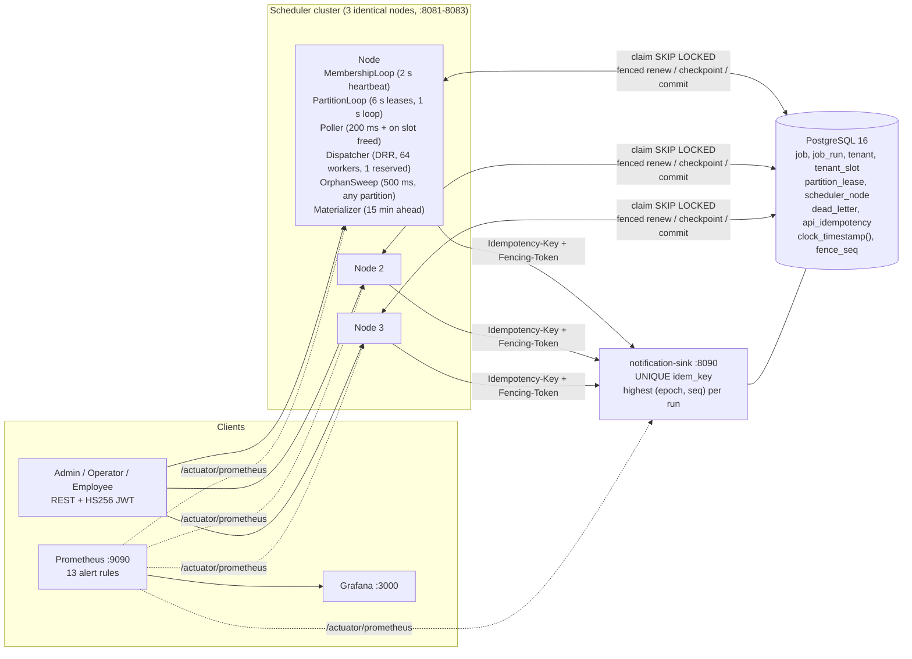

# Design note: distributed trip job scheduler

A short version of the design. The full plan is [`PLAN.md`](../PLAN.md); measured numbers are in [`BENCHMARK.md`](BENCHMARK.md).

## 1. Architecture

Every node runs the same jar and there is no leader. PostgreSQL is the only coordinator and the only clock that decides due times and lease expiry. Work is split into 128 fixed partitions, each with its own lease row, so no single row is a hot lock.



In compose, each node reaches Postgres and the sink through its own Toxiproxy proxy, so one node can be cut off without touching the others. The sink uses its own `sink` schema in the same database.

## 2. Claim, execute, fenced commit, takeover

```mermaid
sequenceDiagram
  autonumber
  participant A as Node A
  participant DB as Postgres (the clock)
  participant B as Node B
  participant S as Notification sink
  A->>DB: BEGIN; lock a free slot of tenant T (FOR UPDATE SKIP LOCKED)
  A->>DB: start one due run in it: RUNNING, token (epoch, nextval('fence_seq')) = 7.41,<br/>lease_until = clock_timestamp() + 10 s; COMMIT
  Note over A: token used only after the commit is acknowledged
  A->>S: items 1..50 (Idempotency-Key run:emp, Fencing-Token 7.41)
  S-->>A: 201 DELIVERED (fence for run = 7.41)
  A->>DB: checkpoint {"nextItem":51} WHERE token = 7.41 AND lease_until >= clock_timestamp()
  A->>DB: renew every 3 s, same predicate
  Note over A: killed or frozen here
  Note over DB: lease expires (10 s after the last renewal)
  B->>DB: OrphanSweep (≤ 500 ms later): lock the slot, reap run<br/>(UPDATE ... WHERE lease_until < clock_timestamp()),<br/>restart it in the same slot with token 7.42, same transaction
  B->>S: items 51.. from the checkpoint, token 7.42
  S-->>B: 201, or 200 ALREADY_DELIVERED for re-sent items
  B->>DB: commit SUCCEEDED, slot_no = NULL WHERE token = 7.42 AND lease valid (1 row)
  Note over A: wakes up (freeze case)
  A->>A: self-fence: monotonic deadline (claim + lease − 2 s) passed, stop
  A->>S: (only if a send was already in flight) token 7.41
  S-->>A: 409 STALE_TOKEN, nothing delivered
  A->>DB: commit WHERE token = 7.41 → 0 rows: lease lost, not a job failure
```

Takeover bound after a crash: 10 s lease + 0.5 s sweep + about 0.2 s claim = **10.7 s**, in any partition and whatever the partition-lease timing. Measured: 9.99–10.15 s (`NodeCrashIT`), 7.97–8.22 s (`EndToEndKillIT`). New runs that fall due in a dead node's partitions wait for its 6 s partition lease instead, up to about 7 s.

Between the 200 ms polls, a node also claims for a tenant as soon as one of that tenant's runs finishes on it (at most 4 such claims at once per node). That refills a freed slot within one round trip, so a capped tenant drains at about cap / 46 ms ≈ 700 runs/s instead of cap / 200 ms.

## 3. Why the effect happens exactly once

Exactly-once *execution* is impossible: a node that sent an alert and died before recording it looks the same as one that died before sending. So runs are executed **at least once**, and the **effect** is made exactly-once:

- **Deterministic idempotency keys.** A scheduled run's key is `{jobId}:{scheduledAtUtc}`, a manual run's is `{jobId}:manual:{Idempotency-Key}`, and each item inside a run adds `:{employeeId}`. `UNIQUE (job_id, scheduled_at)` and `UNIQUE (idem_key)` make materialisation and triggers idempotent; the sink stores each key once (`sink.delivery` primary key) and answers repeats with `200 ALREADY_DELIVERED`. A dead-letter replay reuses the same row and key.
- **Fencing token `(epoch, seq)`.** Every claim gets `seq = nextval('fence_seq')` and `epoch = cluster_generation × 2^32 + timeline`, so tokens rise within a primary and across every promotion. Every renew, checkpoint and commit is `WHERE (fencing_epoch, fencing_seq) = (:e, :s) AND state = 'RUNNING' AND lease_until >= clock_timestamp()`: an expired lease can never be renewed or committed, even if nobody took the run over, and a zombie can never free a slot it lost.
- **The sink's highest-token check.** The sink keeps the highest `(epoch, seq)` it accepted per run and rejects anything lower with `409 STALE_TOKEN` before it looks at the key. That covers the one window the DB cannot: a frozen node that wakes between its self-fence check and its HTTP call.
- **Startup epoch guard.** A node refuses to start if its epoch is below the sink's `GET /api/v1/fence/highest-epoch` (a database rebuilt from `initdb` restarts at timeline 1; operators raise `cluster_generation`).
- **Caps cannot be exceeded either.** A running run must hold one of its tenant's `tenant_slot` rows (CHECK + composite FK + partial unique index), and a slot passes on only after a conditional reap of the old holder, so at most `cap` runs per tenant hold a valid lease at any moment.

The proof is in the tests: `ExactlyOnceEffectIT` (10,000 jobs with forced failures after the send: 10,000 distinct keys, none twice, more than 10,000 attempts), `TenantCapIT` (no tolerance, 10 ms samples), and the benchmark (100,000 runs with a kill and a freeze: 0 duplicates, `maxDeliveriesPerKey` 1).

## 4. Failure modes

| Failure | Detection | Behaviour | Test that proves it |
|---|---|---|---|
| Node crash (`kill -9`) mid-run | Run lease (10 s) not renewed; `lease_until < clock_timestamp()` | Orphan sweep on any node reaps and restarts the run in the same slot with a higher token, from its checkpoint; the sink absorbs the re-sent tail of the chunk. Takeover ≤ 10.7 s. Its partitions move within about 7 s | `NodeCrashIT`, `EndToEndKillIT`, `RebalanceIT`, `chaos/kill-during-alerts.sh` |
| Node freeze / long GC pause | Same lease expiry; on wake-up the node's own monotonic deadline (`claim + lease − 2 s`) has passed | Another node takes over as above. The woken node self-fences; an in-flight send gets 409; its renew, checkpoint and commit match 0 rows (counted in `scheduler_lease_lost_total`, `scheduler_stale_commit_rejected_total`). A session frozen inside a transaction is ended by `idle_in_transaction_session_timeout=5s` (compose) | `GcPauseIT`, `EndToEndFreezeIT`, `TenantCapIT`, `LeaseResurrectionIT`, `chaos/freeze-during-alerts.sh` |
| Renewal racing slot reuse | Both are conditional updates of the same run row | Postgres serialises them; exactly one wins | `SlotStealRaceIT`, `LockOrderIT` |
| DB failover (production, Patroni) | Patroni leader lease in etcd; new timeline | Only the synchronous standby is promoted (F1–F3), so nothing acknowledged is lost; the new timeline raises the epoch, so old tokens lose everywhere; writes block if no synchronous standby is left (F2). A rebuilt cluster is caught by the epoch guard | `FailoverFencingIT`, `StrictSyncIT` (Docker-gated, not run locally), `EpochGuardIT`, `ClusterGenerationGuardIT` |
| DB unreachable | Claims and renewals throw | No job fires (consistency over availability); nodes cannot renew, so they self-fence; API returns `503 SCHEDULER_STORE_UNAVAILABLE`; on return the misfire policy handles the backlog | `ErrorResponseTest`, `MisfireIT` |
| Sink outage or slow sink | HTTP 5xx, timeout (request timeout 5 s) | Retryable: full-jitter backoff (base 2 s, cap 5 min), then `DEAD_LETTERED` after `maxAttempts` (default 5); operator replays with the same key (a `SKIP`/`COALESCE` job replayed after its misfire threshold is skipped instead, because replay keeps the original `scheduled_at`). The tenant cap limits the damage to the tenant whose runs are stuck | `RetryToDeadLetterIT`, `HttpEffectSinkTest`, `FaultInjectionIT` |
| Sink says "already delivered" | `200 ALREADY_DELIVERED` | Treated as success | `ExactlyOnceEffectIT`, `EndToEndKillIT` |
| Network partition (node cut off from DB) | Renewals fail (`scheduler_lease_renew_failures_total`) | The cut-off node cannot renew, self-fences before the lease ends, and its fenced writes fail when it returns; the rest of the cluster takes over as for a crash. A node cut off only from the sink retries and then dead-letters | `FencingIT`, `LeaseResurrectionIT`, `TenantCapIT` (Toxiproxy proxies exist in compose for manual drills; no automated test uses them) |
| Clock skew on a node | Not needed | Due times, leases and lag are SQL predicates on `clock_timestamp()` of the primary; node clocks only affect log timestamps. Self-fencing uses the node's monotonic clock, which skew does not move | `FencingIT`, `ClaimRaceIT` (all lease checks on the DB clock) |
| DST gap and overlap | `WallClockResolver` on every occurrence | Gap (02:30 on spring-forward) fires once at 03:00 local; overlap (01:30 twice) fires once at the first 01:30; keys use the resolved instant | `WallClockResolverTest`, `NextFireTimesTest`, `MaterializerIT` |
| Cluster downtime (missed fire times) | Claimed more than `misfireThreshold` (60 s) late | `FIRE_NOW`, `SKIP` or `COALESCE` per job | `MisfirePolicyTest`, `MisfireIT` |
| Cap lowered below the running count | Slot rows above the new cap still held | Free high slots deleted at once; held ones drain through compaction; no new start until running < new cap | `CapReductionIT`, `CapApiIT` |
| One tenant floods 50,000 runs | — | That tenant drains at its cap; others start within a poll (measured B max 185 ms) | `TenantFairnessIT`, `DrainRateIT` |

## 5. What is not covered

- The compose stack, the chaos scripts, the Patroni setup and the compose-mode load generator have never been run here (no Docker). `ComposeConfigTest` checks the compose file and the scripts pass `bash -n`.
- In the benchmark the 2 s p99 target is missed for runs that fall due in a dead or frozen node's partitions during the few seconds before its 6 s partition lease expires (p99 3.7 s after the kill, 5.3 s after the freeze, in that window). Running runs are not affected, and overall p99 stayed at 291 ms.
- The max-run-time hard stop (`TIMEOUT`) is implemented but has no dedicated test. Finished runs are never deleted (no `job_run` retention job yet).
